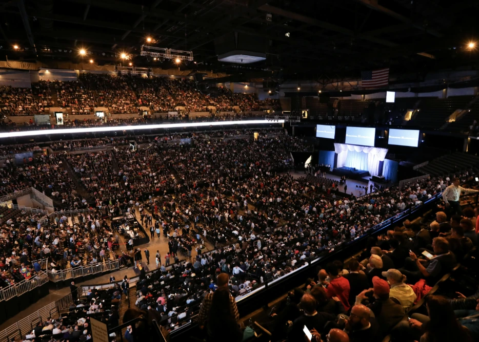
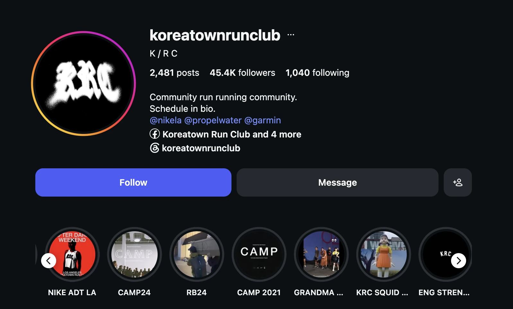

There is one event that gathers more wealthy people in one place than any other on Earth.

It is not on Wall Street. It is not in Silicon Valley.

Once a year, 40,000 investors make the trip to Omaha, Nebraska. People call it the Woodstock for Capitalists. Some call it a BTS concert for boomers.

The Berkshire Hathaway annual meeting. Sixty years and running.

This year, Berkshire posted record results. Earnings doubled.

And the arena was only a little over half full.

What changed?

One man was missing from the stage. In January, Warren Buffett handed the CEO job to his successor, Greg Abel. At this year's meeting he handed over the microphone too, and took a seat in the audience. He is 95.

Think about who fills those seats. Traditional American boomer investors, the most numbers-driven crowd you will ever meet. Show them doubled earnings and they should come running.

They didn't. The host changed, and half of them stayed home.

That arena in Omaha is showing us the most important force of the AI era.

The power of the host. Now let's change the stage.

## Run Clubs Are the New Nightclubs

In 2026, the Friday night line for Gen Z forms outside a run club.

By Strava's own count, run club participation grew 59% in a single year, and the number of new clubs quadrupled. Strava put it plainly in its report: run clubs are the new nightclubs. People who said they would rather meet someone through exercise than at a bar outnumbered the opposite answer four to one.

Meanwhile, the bar is emptying. The share of American adults who drink has fallen to the lowest point in Gallup's 90 years of polling, and global alcohol companies have watched $830 billion in market value evaporate.

A half-empty arena in Omaha. A packed run crew on a Friday night.

People want to gather. But not just anywhere.

They gather where there is a host. Or rather, they gather when a host gathers them.

In Be a Messenger, I wrote about the person AI cannot replace. If the messenger is the one who speaks, the host is the one who gathers. The host is the messenger of physical space.

The new power of the AI era. The host.

## AI Will Talk to You All Night. You Will Still Be Lonely.

Online is getting close to free. Gatherings are getting scarce.

And the AI era is dragging up humanity's oldest fear: loneliness.

Loneliness has moved from a mood to a public health problem. According to the U.S. Surgeon General's advisory, loneliness raises the risk of premature death by 26%. The mortality impact of social disconnection is comparable to smoking up to 15 cigarettes a day.

Into that world walked AI. As a conversation partner, the chatbot is perfect. Always awake. Always kind. Always on your side. 72% of American teenagers have already talked with an AI companion.

Here is the most ironic study in this essay.

OpenAI teamed up with MIT and analyzed nearly 40 million ChatGPT interactions. The heavier the user, the higher the loneliness and emotional dependence, and the less time spent with actual people.

This didn't come from a critic or a rival lab. It came from OpenAI's own research: the more you talk to AI every day, the lonelier you tend to be. Lonely people turn to AI, and AI leaves them lonelier. That loop may be one of the biggest problems modern society faces.

So did everyone run back offline? No. That's the second problem.

Offline gatherings are still shrinking. According to the American Time Use Survey, the time people spend socializing face to face has dropped more than 20% over the past 20 years. For people under 25, it has dropped more than 35%.

Offline did not come back. It got scarcer.

And scarcity is relative. The more AI supplies endless conversation and copies endless content, the more a conversation in the same room, at the same hour, is worth. The total shrank, so every gathering still standing got more expensive.

## Hosts Are Old. Their Power Is New.

Hosts are nothing new. There have always been meetup organizers, club presidents, group chat admins, forum moderators.

So why are hosts rising now?

Back to AI, again.

AI still demands two things from us: trust and accountability. They are the heaviest things a human can carry, and a host is someone who carries both.

The barrier to entry fell, too. Social media opened a road for anyone to become an influencer. Now a road is opening for anyone to become a host.

Not long ago, hosting an event meant promotion, paid ads, and guessing until the last minute how many people would actually show up. Not anymore. Social media and a dozen communication platforms let you find as many people who share your interests as you like, and meet them.

And this golden age of gatherings is opening a new economy.

## The Host Is the New Influencer

The influencer economy has an open secret.

The more followers you have, the less people respond. By one Instagram analytics platform's count, nano influencers with under 10,000 followers see 1.78% engagement. Mega influencers with over a million see 0.33%. A five-fold gap.

Likes are common. Follows are common. In an era when AI supplies content without limit, they will get more common still. Only one thing stays rare: presence. Showing up.

A rainy Thursday, 7 p.m., hauling your body to one place. That is a different currency from a like. It can't be copied, and it can't be automated.

Why the reversal? Inflation. Not of money, but of followers and engagement.

More than 50 million people on the planet now call themselves creators, and that number grows 10 to 20% a year, by Goldman Sachs' estimate. Ten thousand followers, even a hundred thousand, starts to look like nothing. AI makes the inflation worse. A currency that costs nothing to print always loses value.

Gatherings are the opposite. You can't print them.

Anyone who has tried to get ten people into a room knows how hard it is. By industry counts, close to half of the people who register for a free event never show up. Move it to Zoom and nothing changes but the screen. Everyone still has to give up the same hour. A human body can only be in one place at a time.

The interesting part is what happens when you charge. No-show rates at paid events drop to single digits. Put a price on attendance and people start treating attendance like money.

In the influencer economy, power was followers and engagement.

In the host economy, power is members and attendance rate.

If followers are a currency printed without limit, attendance is gold. Followers can be bought, and it is getting harder to tell the real ones from the fake. Offline attendance can't be faked. (Faking it would cost too much.)

The host economy is offline's revolt against the follower inflation the AI era brought.

## A Thousand True Fans, and 800 Runners

In 2008, Kevin Kelly, the founding executive editor of Wired, wrote an essay that saw this coming. His argument, in one line: a creator only needs 1,000 true fans to make a living.

1,000 fans is a huge number.

1,000 followers is nothing.

As reality gains value in the AI era and offline gets scarce, 1,000 true fans carries weight again.

The 2026 version of that line: someone who gets 800 people running every week doesn't need to envy a million followers.

Koreatown Run Club, Los Angeles. A neighborhood meetup two people started in 2016. Today, 800 to 1,000 people show up to run every week. Nike made the crew its official LA partner and put out a sneaker collaboration with them.

Nike didn't buy content. It bought an attendance sheet: 800 people in one neighborhood, every Thursday night.

As I wrote in Be a Messenger, there are only two things a human can guarantee in the AI era: trust and accountability. Becoming a host means carrying both under your own name.

The host is the messenger of physical space. Who comes. What gets said. What happens. All of it carries the host's signature. Stack those signatures and you have a community.

People aren't loyal to platforms. They are loyal to hosts.

An influencer needed tens of thousands. A host needs dozens, a few hundred at most.

In the AI era, the host is the new influencer.

If you want to survive the AI era, be a host. A host can't be replaced by AI.

## Conclusion: In the AI Era, Be a Host

So what do we actually do? How does someone become a host? Easier said than done.

Start with the skills. These are the skills that make a person AI can't replace:

-   Leadership
  
-   Communication
  
-   Coaching
  
-   An eye for detail
  
-   The warmth to make every guest feel at ease
  
-   A nerdy obsession worth building a gathering around
  
-   And most important, curation
  

Look at the kind of person AI can't replace, and the skills this era needs most come into view on their own.

You can start small. Your first gathering can be modest. What matters is that there is a second one. People will drop out. New people will come in. The one who says "See you next time" and makes everyone else feel safe. That's a host.

And curation is a skill of its own.

A host's real power lies in the invitation, not the microphone. Deciding who ends up in the same room. That is editorial power, and AI can't copy it.

Good hosts don't make content. Content grows out of the moments and experiences the host creates.

That is the job. Bringing people together and giving them an experience that matters.

A person no AI can replace.

If you want to win in the AI era, be the Host.

Next, let's apply this to companies. What does a company AI can't replace look like? That's the next chapter: Create a Tradition.

\- JKIMMORGAN, ai storian
