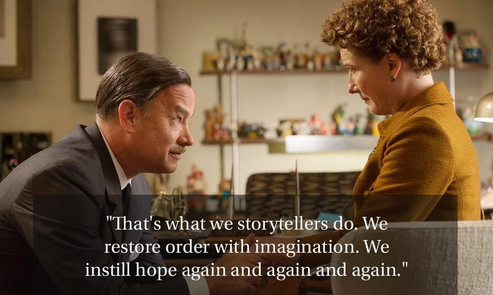
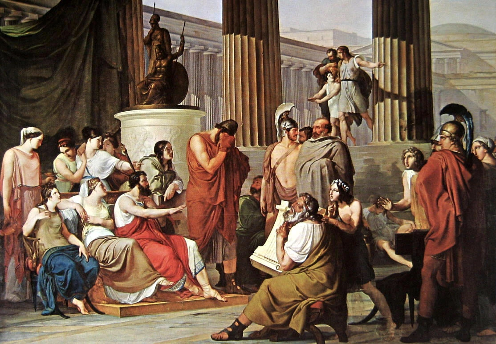
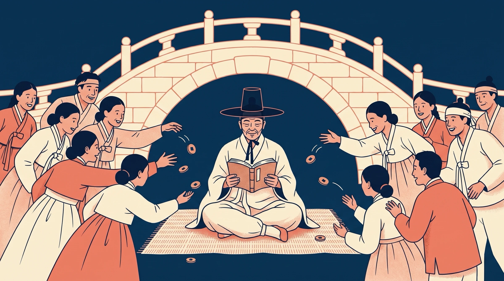
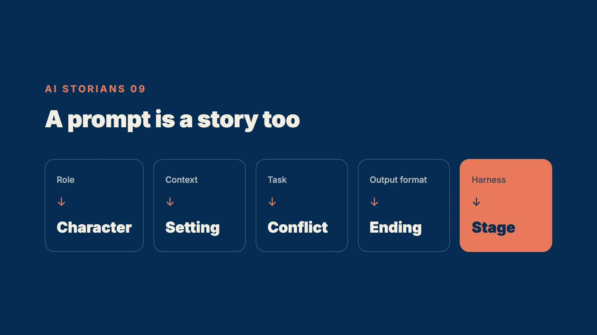
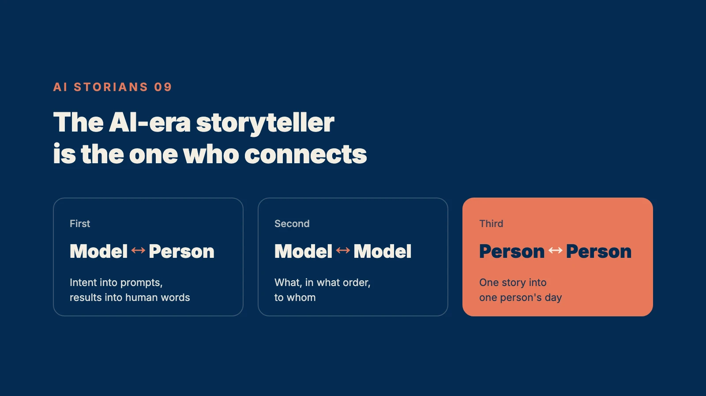

"That's what we storytellers do. We restore order with imagination. We instill hope again and again and again."

That is Walt Disney, played by Tom Hanks, in Saving Mr. Banks (2013).

In the film, Disney has spent twenty years chasing one writer. P.L. Travers, the author of Mary Poppins.

He promised his daughters he would turn her book into a movie.

Travers keeps saying no.  
She is sure he will ruin it. Turn it into a cartoon full of singing and dancing.

But that isn't the real reason.  
The father in the book, Mr. Banks the banker, was her own father. A man undone by drink, who left his daughter far too early.

Disney figures it out. He flies to London and goes to see her.  
And he tells her that Mr. Banks will be saved. Maybe not in life, but in imagination.  
That's what we storytellers do.

Travers finally signs over the rights.  
Mary Poppins became a film in 1964, and children all over the world still remember that umbrella.

Look at what Disney actually did.  
He didn't write a new story. The story was already in the book.  
What he did was carry it out of one woman's wound and bring it to every child in the world.  
And he called that work hope.

So what is a storyteller in the age of AI?

## Storytellers Used to Be the People Who Remembered

This summer, a 2,700-year-old story sold ten million tickets in South Korea.

Christopher Nolan's The Odyssey.

It opened in early August and crossed ten million admissions in 33 days. In Korea, ten million is the summit, the line that turns a hit into a national event. It passed Interstellar to become Nolan's biggest film ever in Korea. Worldwide, it has grossed more than $1 billion.

The original author is Homer.  
Although "author" is the wrong word for him.

In Homer's time, the Odyssey was not a book. It was a song.  
Wandering poets memorized all of it, more than 12,000 lines, and sang it through the night at feasts. It was written down much later.

The first line goes like this:  
"Tell me, Muse, of the man."

The poet does not claim to make the story.  
He asks a greater wisdom, the Muse, to tell it to him, and he carries it to the people in the room.  
Twenty-seven centuries ago, a storyteller introduced himself as a connector, not a maker.

Hold on to that. We'll come back to it.

Homer wasn't alone.

West Africa had the griots. Royal genealogies, wars, marriages, promises. Everything nobody wrote down, they carried in their heads and passed on in song.  
In 1960, the Malian writer Amadou Hampâté Bâ made a plea at UNESCO:  
"In Africa, when an old man dies, a library burns."

Korea had the jeongisu.  
Under the Joseon dynasty, Korea's last royal house, they were professional storytellers who read novels aloud for money. Books were expensive, and few people could read.

Go back further.

In the 1970s, the anthropologist Polly Wiessner recorded the conversations of the Ju/'hoansi people in the Kalahari.  
Daytime talk was about work. Land, hunting, sharing. And complaining. A third of daytime conversation was complaint and criticism.  
Then the sun went down and people gathered around the fire, and the talk changed.  
Of the long conversations among groups at night, 81% were stories.

Wiessner wrote that stories, along with gifts, were humanity's first social media.

Homer. The griots. The jeongisu. The old man by the fire.  
Different names, same job.  
Remember the stories other people don't have, and bring them to the people.

The storyteller used to be the one who had the information.

## Then Information Became Infinite

AI flipped that formula completely.

The 12,000 lines a wandering poet spent his life memorizing, AI pulls up in a second.  
The genealogies the griots guarded, AI lays out in a single search.  
The novels the jeongisu read aloud at the top of their lungs, AI rewrites at any length, in any voice, with any ending you like.

And it is printing more as you read this.  
According to a study released this May, half of the new English-language articles on the web are now written mostly by AI.  
The cost of producing a piece of writing is heading toward zero.

In the essay on platforms, I wrote that the things becoming abundant are intelligence, information, features, and content.  
When information gets cheap, so does the person who holds it.

When an old man dies now, no library burns.  
It's all on a server.

So is the storyteller finished?

No. The opposite.

Think about it. The Odyssey has not disappeared once in 2,700 years. It's in every library. You can read it online for free.  
And still, this summer, ten million people went to a theater for it.  
They didn't go because the story was missing. They went because someone showed up to tell it again.

In 1971, Herbert Simon, who would later win the Nobel Prize in economics, wrote this:

"What information consumes is rather obvious: it consumes the attention of its recipients. Hence a wealth of information creates a poverty of attention."

He wrote that 55 years ago.  
When information becomes infinite, information is not what runs short.  
What runs short is the time of the person on the receiving end.

In the essay on automation, I wrote that in the agent era, the bottleneck moves from execution to approval.  
The same thing is happening to stories.

Making is no longer the bottleneck.  
Delivery is.

## The Attention Economy Only Gets Crueler

There's a scene in the Odyssey.

Odysseus, who has not been home in twenty years, washes up at the palace of the Phaeacians, in a land he doesn't know.  
He is a shipwrecked man with nothing. No ship, no crew. He hasn't even given his name.

There is a feast, and a blind poet sings of the Trojan War.  
Listening, Odysseus covers his face and weeps. The hero of the song is him.

The king asks who he is.  
And Odysseus begins his own story. His first words:

"What shall I tell you first, and what last?"

That night he tells everything. The one-eyed giant, the witch Circe, the Sirens, his journey to the land of the dead.  
When he finishes, the king and his nobles pile gifts on him and give him a ship to carry him home.

What brought a penniless castaway home was not a sword, and not money.  
It was a story.

And his first worry was not what to say. It was what order to say it in.  
Even 2,700 years ago, the storyteller's job was delivery more than information.

The jeongisu knew this too.

Jo Su-sam, a poet of late Joseon Korea, left a record of one old jeongisu who lived outside Seoul's East Gate.  
He knew the popular novels of the day by heart (Sukhyang-jeon, So Daeseong-jeon, Simcheong-jeon, Seol In-gwi-jeon) and read them aloud.  
Under the bridges over the Cheonggyecheon stream, at Baeogae, at Gyodong, in front of the bell pavilion. He moved every day and made a full circuit of the city once a month.

And he had a trick.  
When the story reached its most gripping moment, the part everyone was waiting for, he would suddenly stop and fall silent.  
Desperate to know what happened next, people scrambled to throw coins at him.  
Only then did he read on.

People called it yojeonbeop. Roughly, "the art of summoning money."

Sound familiar?  
The TV episode that cuts off in the final minute. The next episode that plays automatically. The web novel chapter that ends one line before the pay button.  
Two hundred years ago, on the streets of Seoul, the cliffhanger business model was already complete.

Was there anyone who didn't know the story of Sim Cheong, the daughter who gives up her life so her blind father can see? In Korea it was as familiar as Cinderella.  
People weren't throwing coins for the plot. They were paying for the telling.  
The skill of making you need what comes next. The skill of holding a person's attention.

AI multiplies this game.  
Content becomes infinite, but a person's day is still 24 hours.

According to research by the psychologist Gloria Mark, the time people keep their attention on a single screen fell from 2 minutes 30 seconds in 2004 to an average of 47 seconds today.  
Infinite stories are now fighting over 47 seconds.

The price of information falls. The price of attention rises.  
And the higher the price of attention, the more the person who can hold it is worth.

That person is the storyteller.

In Be a Messenger, I wrote that the more common messages become, the more "who said it" matters.  
If the messenger is a question of trust, the storyteller is a question of delivery.  
Even a trustworthy person isn't heard if they can't keep you listening to the end.

## A Prompt Is a Story Too

So far, this has been about people.  
But the AI era has given us a new audience.

The AI model.

These days I spend a good part of each day telling stories to AI.  
This series is made that way. An AI that finds sources, an AI that checks the numbers, an AI that checks whether the writing still sounds like me.  
Before I hand any of them a job, I write each one a short story.  
Who you are. Who this piece is for. Why it matters. What should be left standing at the end.

A one-line "Do some research" and those four lines get different results.

That's not just my impression. Anthropic, the company behind Claude, says it in its official prompting guide: don't just give instructions, give the reason and the context for why they matter. The model understands the goal better and answers more accurately.

The example they use is a good one.  
"NEVER use ellipses" works worse than "Your response will be read aloud by a text-to-speech engine, so never use ellipses since the text-to-speech engine will not know how to pronounce them."

AI does better when it knows why, too.  
It moves when it hears a story.

In January 2023, Andrej Karpathy, a founding member of OpenAI, wrote:  
"The hottest new programming language is English."

By 2025, the industry had changed its vocabulary. Not prompt engineering. Context engineering.  
Karpathy's definition: the delicate art and science of filling the context window with just the right information for the next step.

Early this year, it went one step further. Harness engineering.  
Mitchell Hashimoto, the developer who created Terraform, gave it that name. When an agent makes a mistake, you fix its working environment so it never makes that mistake again.  
Six days later, OpenAI published a post under the same name. Humans steer. Agents execute.

The names keep changing. Prompt, context, harness.  
Take them apart, and it's all the same work.

The role is the character.  
The context is the setting.  
The task is the conflict.  
The output format is the ending.  
The harness is the stage.

A prompt is the story that lets you talk to an AI model most effectively.  
Harness engineering is simply stringing those stories together into a full play.

Remember Odysseus's first worry. What first, what last.  
That is exactly the question a good prompt writer faces every day.  
What to tell the model first, and what to stress at the end.

In Be a Messenger, I described the real 0.1% of AI users this way. They assign different jobs to different models, design feedback loops, and tighten the system until the output is exactly what they wanted.

Read it again, and it's a director's job.  
Cast the actors, break down the scenes, shoot again until you get the performance you want.  
What Nolan did making The Odyssey and what the 0.1% do working with AI look more alike than you'd think.

Here, the wall between the 99% and the 1% gets a little lower.  
You don't need to know code. If you can write a good story, you can write a good story for AI.

## The Storyteller Is the One Who Connects

Now back to the first line of the Odyssey.  
"Tell me, Muse, of the man."

Homer asked a greater wisdom and carried what he heard to the people.  
Twenty-seven centuries later, we have a new Muse of our own.  
An AI model that has read nearly everything humanity ever recorded, and answers whenever you ask.

The old storyteller was the person who had the information.  
The storyteller of the AI era goes back to Homer.  
The one who connects.

First, connect the model and the person.  
Turn a person's intent into a story the model understands. Turn what the model produces back into a story people understand.  
Ask the Muse, then sing to the people.

Second, connect model to model.  
This is the era of agents handing work to other agents.  
In 2024, Anthropic released a standard for connecting AI to tools and data (MCP). In 2025, Google released a standard for agents to talk to each other (A2A).  
The pipes are laid.

But no one will decide for you what flows through those pipes, in what order, to whom.  
How to hand the research AI's findings to the writing AI. What to tell the fact-checking AI to doubt.  
That's plotting.

Third, connect people to people.  
This was the storyteller's job from the very beginning. By the fire, at the Phaeacian feast, under the bridges of the Cheonggyecheon.  
However many stories AI pours out, someone still has to pick one and place it in one person's day.  
Someone has to make ten million people hold their breath at the same scene.  
That is still a human job.

Homer connected the Muse and the people.  
The griots connected kings and commoners, the past and the present.  
The jeongisu connected books and people who couldn't read.  
Disney connected one writer's wound and the children of the world.

The storyteller of the AI era connects models to people, models to models, and then brings all of it back to people.

That connection is the story.  
And the person who makes it is the storyteller.

## Conclusion: In the AI Era, Be a Storyteller

At the very start of this series, I explained its name.  
Story plus Historian. Storians.  
Don't stop at reading the past. Become people who make history with our own stories.

Today I fill in the first half of that name.

Here is what "be a storyteller" means in practice.

**One. Design the delivery.**

Before you decide what to say, decide the order that keeps people listening to the end.  
Odysseus did it. The jeongisu did it. What first, what last. Where to stop.  
AI fills in the information. You set the order, the pauses, and the rhythm.

**Two. Tell AI a story, too.**

Instead of a one-line command, a four-line story.  
Who it's for. Why it matters. What to watch out for. What should be left at the end.

In Be a Messenger, I wrote that today's prompt trick is tomorrow's default feature.  
That's true. Tricks get old.  
The ability to tell a story doesn't. The Odyssey hasn't gotten old in 2,700 years.

**Three. Stand where things connect.**

Between the model and the person. Between one team and another. Between the people who know and the people who don't.  
Find the places where information breaks, and stand in the gap.  
In the AI era, the seat of honor goes to whoever connects the most, not whoever knows the most.

One last time, back to Disney's line.

The storyteller restores order with imagination and instills hope. Again and again.

Honestly, this is a time when anxiety is more common than hope.  
Every week someone warns that if you don't learn AI, you'll be left behind.  
And AI prints that anxiety in infinite supply, too.

That's exactly why we need storytellers.  
Someone who finds order in the flood of information and leaves one piece of hope at the end of it.  
That is what this series has been trying to do since its first page.

Look for it in your own work today.  
Open the last job you handed to AI. Was it a command, or a story?  
And when the result came back, who did you pass it to, and how?

Information is infinite.  
Delivery is not.  
The person who connects the two is the storyteller.

If you want to win in the AI era, be a storyteller.  
That's what we storytellers do.

\- JKIMMORGAN, ai storian
