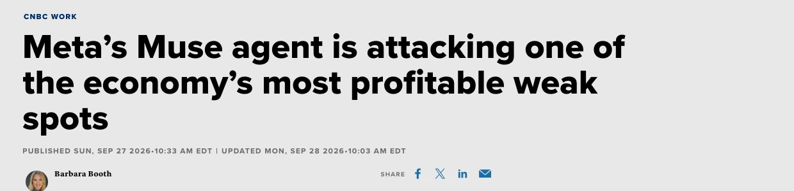
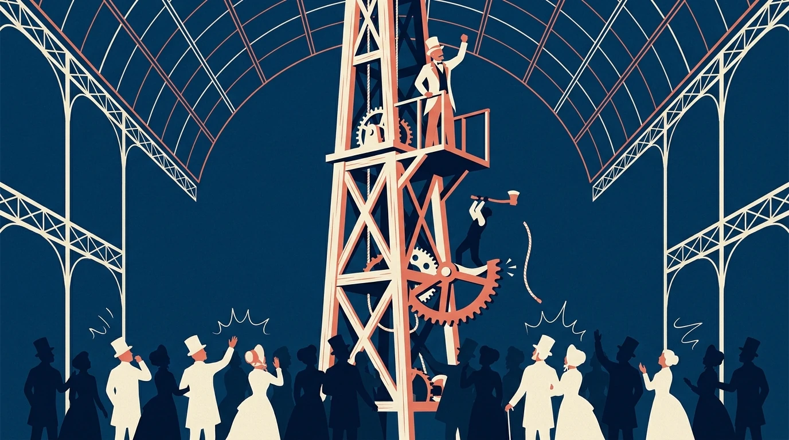
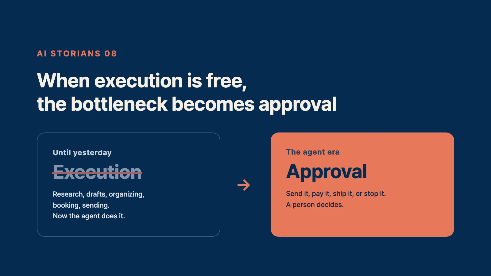
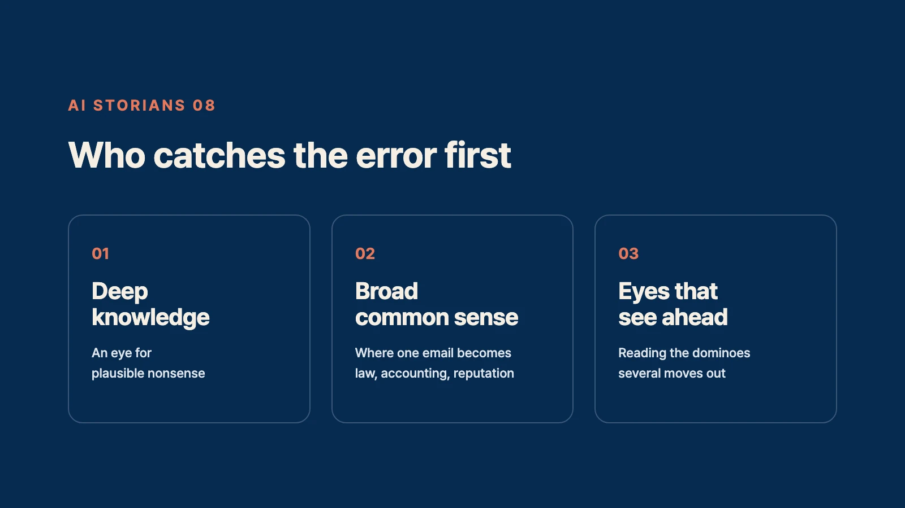

Over three weeks in September, something strange happened in Silicon Valley.

Meta gave its own ad space to a product that was ten days old.

Ahead of Facebook. Ahead of Instagram.

The company's biggest apps waited in line behind a newcomer.

The newcomer is called Muse. It's Meta's AI agent.

What's an agent? An AI that does things for you.

Not a chatbot that only talks. It browses the web, fills out forms, sends emails, books trips, and pays. It keeps working after you close the app.

The game actually started a while ago.

Open-source agents like OpenClaw were powerful, but you had to install them yourself. They were toys for a small crowd.

Claude Code turned the developer world upside down, but only developers used it.

Grok Bot polished the idea for ordinary people, but it cost $200 a month.

Muse was different. You use it in WhatsApp, the way you'd text a friend. And Meta owns the biggest distribution network in the world.

It's what I said in the last essay. Features didn't decide the race. Distribution did.

Muse took off in the US first. In countries where it hasn't launched yet, people are posting about installing a VPN just to try it.

Then, on September 29, OpenAI answered at its DevDay. Dots, an agent that lives inside ChatGPT.

The agent war has begun.

We're entering the era when AI really will do anything for you.

Today I want to talk about the other side.

## But There's One More Strange Thing

While Muse was taking off in America, something happened quietly.

Amazon blocked Muse.

An agent walking into Amazon to shop for you? A violation of its terms, Amazon said, and shut the door.

Shopify did the opposite and opened its door. That block and that opening turned into a debate across the whole industry.

To be honest, Amazon's block looks less like safety and more like protecting its lunch.

When an agent shops for you, you never see Amazon's ads. You never see its recommendations.

That's exactly why this moment matters. The power to stop is, all by itself, power.

One more thing. Even Meta, the company that built Muse, didn't just let it loose.

Muse only works inside a sealed room called a "secure virtual machine."

The company that built the agent built the cage first.

See it?

The companies building automation are, at the same time, building ways to stop it.

The companies on the receiving end of automation have started fighting over the right to stop it.

The further automation goes, the further anti-automation goes.

That's today's topic.

## What Sold the Elevator Was the Brake

We've seen this before. History rhymes, and this rhyme is exact.

1854\. The World's Fair in New York, inside the Crystal Palace.

An inventor named Elisha Otis puts on a show in front of a crowd, with his own life on the line.

He stands on a platform hoisted high above the floor and has someone cut the rope with an axe.

The platform drops. A few inches later, it stops.

The safety brake Otis invented has caught it.

What he called out to the crowd is still on the record.

"All safe, gentlemen, all safe."

Here's the part that matters. The elevator, a machine for hauling things up, existed before Otis.

People just wouldn't ride it. If the rope snapped, you died.

Otis wasn't selling a way to go up.

He was selling a way to stop.

And that way to stop opened the age of the skyscraper. Only after the brake did people ride up to the 10th floor, the 50th, the 100th. Otis is still the largest elevator company in the world.

Remember this. People don't ride machines that go up. They ride machines that can stop.

Agents work the same way.

The moment you hand over your email, your card, your accounts, the agent becomes an elevator.

People aren't really asking "How good is it?"

They're asking "If it goes wrong, can I stop it?"

## The Bottleneck Moves, From Doing to Approving

Now let's bring it down to you.

Here's how work changes in the agent era.

Until yesterday, you did the work yourself. Research, drafts, organizing, booking, sending. Now the agent does it.

The price of doing falls toward zero.

So does human work disappear? No. It moves.

When an agent brings back 100 finished tasks, someone has to decide.

Which ones go out, and which ones stop.

Do I really send this email? Do I really hit pay? Do I really ship this code?

When execution is free, the bottleneck becomes approval.

In the essay on messengers, I said AI never gives the final signature.

In the agent era, that sentence gets heavier.

An agent can do the work for you. It can't carry the responsibility for you.

So the money moves too.

When everyone is selling automation, money also flows to the side that stops it.

The people who design what an agent is allowed to touch. The security that keeps agents from causing accidents. The audits that check what agents did. The rules for how much to hand them.

If you follow chess, you'll smile here.

Once the engine in your pocket got stronger than the world champion, metal detectors showed up at tournaments.

The better AI gets, the more checking is worth. The same law is now playing out across whole industries.

## Conclusion: Be the One Who Can Say Stop

Let me unpack that.

**One. Be the one holding the stop button.**

However many agents there are, the words "go ahead" still come from a human.

Be the person in your organization who says them.

The person whose name goes on the sign-off line. That's the best seat in the house in the agent era.

But there's a trap.

When an agent brings you 100 things a day, people start approving without reading.

Approve, approve, approve. All that's left is a hand pressing a button.

The real threat isn't that AI replaces you. It's that you become AI's rubber stamp.

So the talent the AI era wants is judgment.

Not the person who stamps. The person who catches the error fast.

**Two. Be the one who designs the safety.**

Otis didn't invent the elevator. He invented the brake, and that's how he came to own an era.

The Otises of the agent era are being made right now.

Permissions, security, verification, audits. The bigger automation gets, the bigger these jobs get, by exactly as much.

And the ability to notice which spot needs a check and which spot needs security becomes even more precious.

So who catches the error fast?

In the AI era, this is who you need to be.

First, someone who knows the field deeply.

Whether an agent's work is actually right or just plausible nonsense only shows to someone who knows the field.

If you don't know, you can't stop it. You can't even see what's off.

"Why study when AI knows everything?" is a popular line right now. It's backwards.

The more AI does the work, the more knowledge about that work matters.

Only its use changes, from knowledge for doing to knowledge for judging.

Next, someone with broad common sense.

Agents will start work in any field. One email becomes a legal problem. One payment becomes accounting. One post becomes your reputation.

The approver has to see where those lines cross.

Deep in one field, wide across the whole world. That's the person who holds the stop button.

Last, someone who can see ahead.

Whether to stop is, in the end, a prediction. If I run this, what happens next? And after that? And after that?

How many dominoes ahead can you see?

It's the very skill chess players call calculation.

Deep knowledge, broad common sense, eyes that see ahead.

Only someone with all three can stop.

And remember, the power to stop becomes power.

Amazon used it to protect its lunch.

The person we need to become uses it to take responsibility.

Since the first essay, this series has kept coming back to two words, trust and responsibility. In the agent era, they translate like this:

Only the one who can stop is the one who can hand the work over.

Look for it in your own work today.

Where does the final approval happen? And in that seat, right now, are you reading, or just stamping?

The agent does the work for you.

It can't take the responsibility for you.

If you want to win in the AI era, be the one who can stop the automation.

Be the one who can say stop.

\- JKIMMORGAN, ai storian
