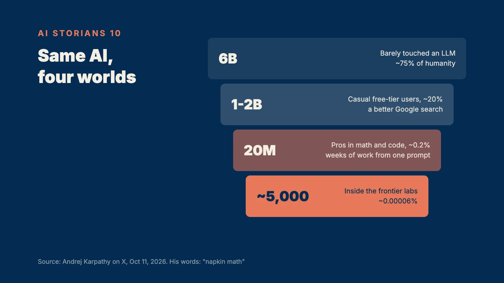

This week, Andrej Karpathy posted something on X.

He is one of the founding members of OpenAI, and the man who coined the phrase "vibe coding."

His point was that the way people understand AI has become "a sharp funnel." He called his own numbers "napkin math."

About 6 billion people, roughly 75% of humanity, have barely come in contact with AI.

Between 1 and 2 billion, about 20%, use the free tier now and then. For them it's a slightly better search box.

About 20 million, 0.2%, watch work that used to take weeks get done in a single prompt.

And then about 5,000 people. Inside the labs, they live in a world where thousands of agents work together for weeks at a time.

It is the same AI.

To some people it's a handful of "derpy chatbots." To others it's "the vertigo of the curve going vertical."

And, in his words, "it is all happening at the same time."

The funny part is that this series was about that funnel from the very first week.

The 99.9% at the top of it. People like us, who don't build AI and don't work inside a lab. What do we survive on in this era, and what do we shine with?

In the first essay, I made a promise.

Use AI well, and you can be in the top 1%.

Become someone AI can't replace, and you can be in the top 1%.

Do both, and you're in the top 0.1%. Then you can rule the AI era.

This is the last essay. Let's see whether I kept that promise.

## Nine Sentences, Three Words

Every week, this series ended on a single line.

**Be a messenger.** Information is cheap. Trust and responsibility are expensive.

**Be a host.** Followers can be printed. Attendance can't.

**Create a tradition.** AI can make anything. It can't make something old.

**Have a good past.** You can get lucky in an interview. You can't run from your past.

**Build a past AI can know.** A past AI doesn't know doesn't exist.

**Own the road.** Features get copied. Roads don't.

**Be the one who can say stop.** When execution is free, the bottleneck becomes approval.

**Be a storyteller.** Information is infinite. Delivery is not.

That's eight.

The ninth, which was really the first, I'm saving for the end.

Lined up side by side, they show me I was asking the same question every week, in different words.

If AI can make anything, what is the one thing that never gets made?

The answer comes down to three words.

**People.**

The person who speaks with their name on the line. The person who gathers others. The person who says "stop." The person who connects one person to another.

The messenger, the host, the one who stops, the storyteller. All four stand in the same spot, the place where trust and responsibility sit.

AI can do the work for you. It can't carry the responsibility for you.

**Time.**

Tradition. A good past. A past AI can know.

Time is the one raw material money can't buy. And in the AI era, time only turns into an asset once it's on the record.

**The road.**

When the ability to make things gets common, the ability to carry them gets rare.

For a person, the road is a list of people who will show up. For a company, it's distribution.

Intelligence, information, code, execution. One click, and there they are.

People, time, the road. No click produces those.

This series was a record of that difference.

## The Way Down the Funnel

Back to Karpathy's post. Two lines stayed with me.

The first.

What splits the funnel first, he wrote, is the size of the problem. "The impact scales with ambition, problem size, and horizon."

Ask questions that want a one-paragraph answer and you have barely tested AI. Only people with big, hard problems they truly care about meet its real power.

The second.

Even in the world of the 5,000 at the very front, "human review and comprehension are starting to fall behind."

Lay those two lines on top of each other, and the 0.1% from the first essay comes into view.

I started this series believing that using AI well and being impossible for AI to replace were two different talents.

Only after writing to the end did I see that they grow from the same root.

An eye for picking a big, good problem.

The skill to turn that problem into a story AI understands. Four lines instead of one, as I put it in the storyteller chapter.

The judgment to check what comes back, and to stop it when it's wrong.

And the ability to carry the result back to people, in human language.

The person who uses AI best and the person AI will find hardest to replace turn out to be the same person. Someone with a story.

The stairs down the funnel and the seat no one can take from you were in the same place all along.

Now I can define what it means to rule the AI era.

You decide what to hand to AI, and you sign the result with your own name.

## Two Sentences for the Questions I Left Open

In the first essay, I raised some questions and moved on.

Should you still study languages? Do music lessons matter? Sports? Should you learn to code? Is college worth it? What kind of people should we raise our kids to be?

I could answer them one subject at a time.

But after ten essays, two sentences are enough.

> Most people won't do it. That is exactly why the people who do become more valuable.

We now hear people ask why anyone should learn a language, an instrument, or code when AI does it all.

That question is the reason the people who learn will become rare. And rare things are expensive.

> In the AI era, broad domain knowledge matters more than deep knowledge.

AI can dig one well very deep in an instant.

Connecting different wells is a human job.

In this era, one email can become a legal problem, one payment an accounting problem, one post a reputation problem.

Whoever sees where those lines cross is the one holding the stop button, and the one who keeps the story connected.

## This Series Was the Experiment

I have a confession.

This series was itself an experiment. I was trying the nine sentences on myself.

Every Wednesday, the same format. Repeat something long enough and it becomes a tradition.

I wrote under my own name. A messenger is someone who signs.

I left it where AI can read it, so that someday, when someone asks an AI how to survive the AI era, this might be one piece of the answer.

And like the investment journal I've kept for years, I hope this record becomes part of my good past.

And every week, you came.

Likes can be printed. Attendance can't.

Your attendance over ten Wednesdays is the biggest asset this series built.

To be honest, I set out to write about ruling the AI era and spent every week learning it myself.

I read up on what I didn't know, fixed what I got wrong, and pulled each essay into the next one.

## Conclusion: It Began With History, and It Ends With History

Time to bring out the first sentence I saved.

August 2016. A middle-aged man in a leather jacket knocked on the door of a small research lab in San Francisco, carrying a box.

Inside was the world's first deep learning supercomputer. On top of it, in marker, he wrote:

"To the future of computing and humanity."

That computer didn't compute the future.

It read the past.

Everything humanity had written, said, and recorded, it read day and night, over and over.

The P in GPT stands for pre-trained. Trained in advance.

The past sits in the middle of the very name that opened the AI era.

Even the machines the 5,000 at the bottom of the funnel work with grew up feeding on that record.

The most future-facing technology ever built is made 100% of the past.

More than sixty years ago, in What Is History?, the historian E.H. Carr described history as "an unending dialogue between the present and the past."

That is exactly what AI does.

And for ten Wednesdays, it's what this series did too.

Which is why the first sentence of this series was this one.

We are all historians of the AI age.

A historian's job was never prophecy.

Historians read the past, and they leave a past behind.

And the future has always been built on top of that record.

Look again at what Jensen Huang wrote on the box.

"To the future of computing and humanity."

The future of computing was inside the box.

The future of humanity is outside it, in the records we leave.

So try one thing today.

Put your name on it, and leave one record somewhere AI can read it.

Next week, on the same day, leave one more.

Most people won't.

That is why you, the one who does, become valuable.

Storyteller, and historian.

We don't stop at reading the past. We make history out of our own stories.

If you want to win in the AI era, become one of the storians.

Be a Storian.

\- JKIMMORGAN, ai storian
