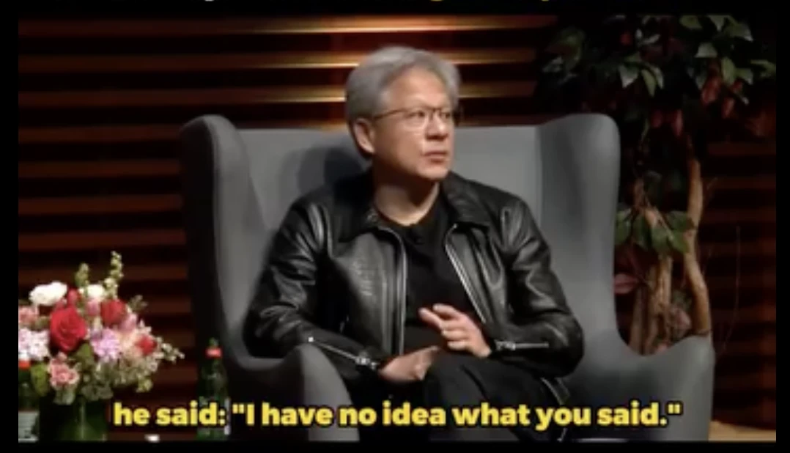
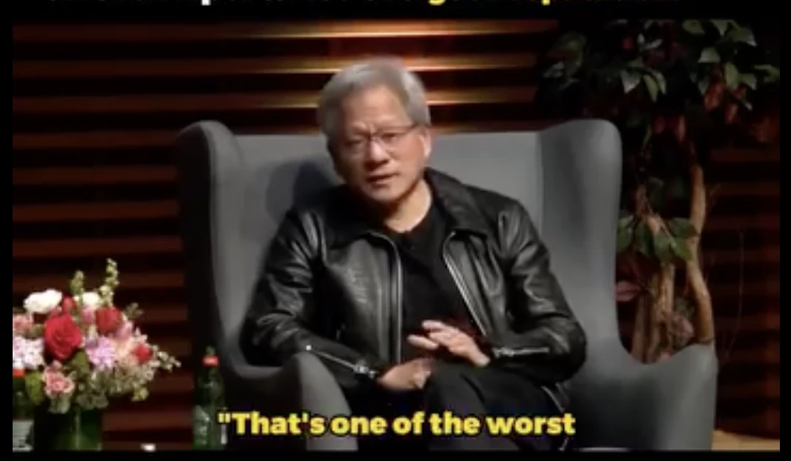
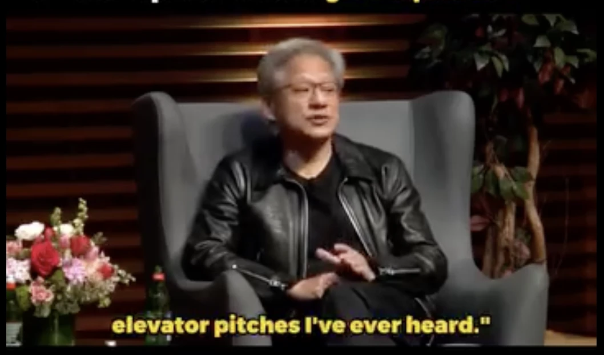
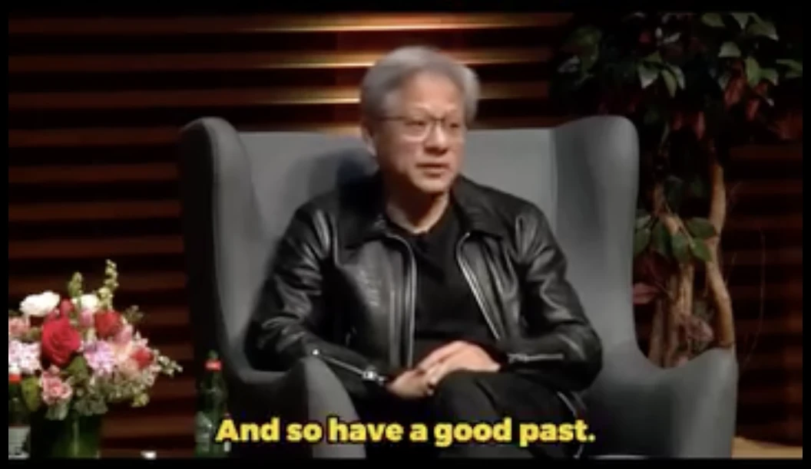

Silicon Valley, 1993.

A thirty-year-old engineer had just quit his job to start a company. The business plan had been sketched out in a corner booth at Denny's.

While he was out looking for investors, a call came in from his old boss: Wilf Corrigan, founder of the semiconductor company LSI Logic.

An employee who left his company was starting something? Wilf was curious. So he called him in.

The young engineer stood in front of his former chairman and pitched his heart out.

When he finished, Wilf said:

"I have no idea what you just said. That was the worst pitch I've ever heard."

And then, right there, Wilf picked up the phone. The man on the other end was Don Valentine. Founder of Sequoia Capital. The legend who backed Apple early.

"Don, I'm sending a kid over. I don't know what he's trying to build, but he's one of the best employees LSI ever had. Give him some money."

That's how the company got funded. The engineer's name was Jensen Huang. The company was NVIDIA.

The pitch failed. His old boss called it "the worst." And by his own account, he was so nervous in front of Don Valentine at Sequoia that he fumbled that one too.

But the investment came through. Because what was being evaluated that day wasn't the performance of the pitch.

It was the time Jensen had put in at that company. How the people who worked beside him remembered him. His past. How Wilf remembered Jensen.

Jensen says this became one of the lessons of his life. In an interview years later, he put it this way:

> "You can get lucky in an interview. But you can't run from your past. So, have a good past."

I've watched Jensen's interviews so many times I could practically recite them. And out of all of them, this is the line most people have never heard. It's not one of the famous quotes. But I think it's the single most important thing Jensen Huang has ever said for the AI era.

## The AI era is the era where your past does the judging

The first reason, I already gave you on the first page of this series.

AI, the most future-oriented technology we've ever built, is made 100% out of the past. It was born by learning from everything humanity has ever recorded. In other words, from the past. When a technology built from the past takes over the world, of course the price of the past goes up.

The second reason is more practical.

Today's performance is now something AI produces for you.

A cover letter? One click. Likely interview questions and model answers? One click. A portfolio, a proposal, a pitch deck... all of it looks respectable within a day. Everyone's "today performance" is being leveled up at once.

So what does the evaluator do? When everyone is good at the same thing, nothing separates anyone. Evaluators retreat to whatever can't be forged.

That's the past.

Where did this person spend their time? What did they actually see through to the end? What do the people who worked with them say? When they failed, how did they get back up?

The reason Jensen got funded after failing two pitches becomes everyone's reason in the AI era. Documents can be made with a click. A reputation can't.

You can prep for an interview in a day. You can't build a past in a day.

## We're already being graded

If "the past does the judging" sounds abstract, look in your pocket.

Uber has a star rating on you. Secondhand marketplaces have your trust score. Your bank has your credit score. Developers have GitHub stars. Every one of these is your past, compressed into a number.

These numbers have three things in common. You can't build them in a day. You can't buy them. And one bad act can wipe them out.

Last episode I talked about tradition. What is tradition? A good past, accumulated collectively. The Masters became a world of its own on ninety years of good past. In the same way, an individual's good past becomes that person's tradition.

A good past is the tradition of the brand called you.

## "But I don't have a good past"

You might be thinking this by now. I've got nothing worth showing. All I've stacked up are failures. Isn't it too late?

I'm someone who has failed an enormous amount. I've had more cringe-at-3-a.m. moments than I can count. As that person, I want to say this clearly:

Today becomes the past the moment tomorrow arrives.

The future can only be planned. The present only flows by. The one tense we can actually build is the past.

"Have a good past" comes down to this: Make good choices today. Start making good choices now. Live today in a way you can stand behind.

Investing is exactly the same. I could swing for a lucky jackpot. I could farm dopamine and outrage if I wanted to. The reason I don't is precisely this: the investment journal I've kept all these years, and the track record that shows it. That's my good past. I don't want to damage it.

A track record compounds. And a single lie liquidates the whole position. The sentence I've repeated throughout this series works exactly the same way here.

## Give your AI a past too

And this doesn't stop with people.

Look at the AI you're using right now. It feeds on the conversations you've had with it, the context you've taught it, the records you've stacked up, and it slowly starts to resemble you. When we "train" our AI, what we're really doing is giving it a past.

That's why the same model gives different people different results. An AI with no history belongs to no one. An AI that has eaten your past is the only one of its kind in the world.

The thing that can never be caught up to in the AI era is the trust, responsibility, and experience a human has accumulated. We just happen to call it the past.

So the more AI there is, the more we should tend our own past. And because it's the AI era, we should give our AI agents a story too. That will turn out to be the biggest asset of all.

## If you can't run from it, make it something to be proud of

Read Jensen's line again.

"You can't run away from your past."

It sounds frightening. But flip it over and it's hope.

"You can't run from it" also means "it doesn't disappear."

The good day you build today doesn't disappear either.

That's why I think consistency will matter more, not less, in the AI era. Start building a good past now.

It's okay to fail the pitch. Jensen failed twice. And he's using even that failed past as part of his story today.

If you won't take my word for it, take the word of the man who built a four-trillion-dollar company.

If you want to win in the AI era, have a good past.

So, have a good past.

\- JKIMMORGAN, ai storian
