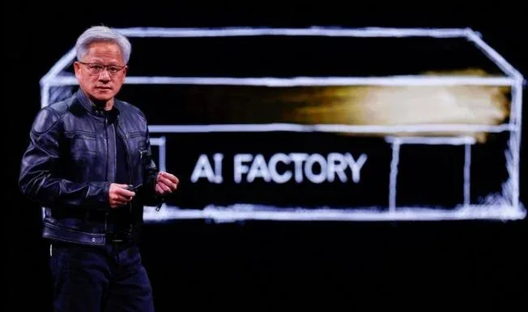
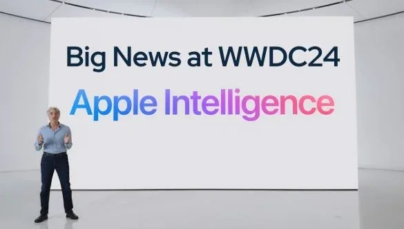
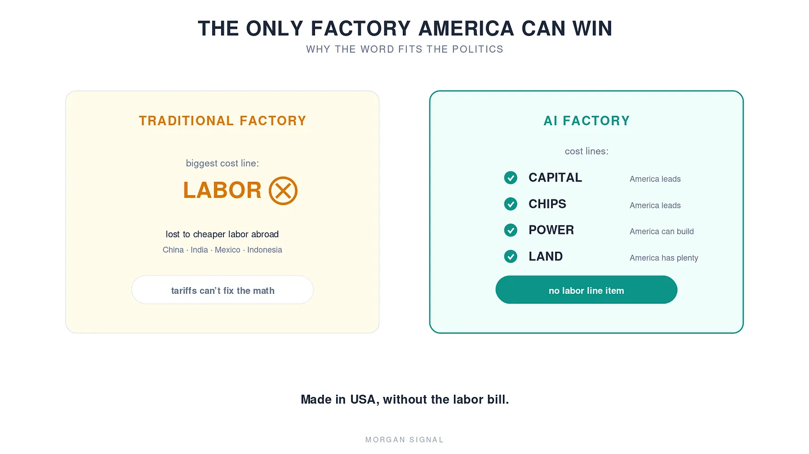

> “The next industrial revolution has begun...  
> To build AI factories... to produce a new commodity:  
> artificial intelligence.”
>
> \- Jensen Huang, CEO of NVIDIA, in 2024

A few years ago at GTC, Jensen introduced a new word. AI factory.

It’s what he calls a data center. It was his “I’m the captain now” moment.

Most people shrugged and moved on. I didn’t.

Because in my experience, when a powerful person renames something, there is always a bigger picture behind it. Political campaigns are won and lost on a single *word*. PR teams agonize over one noun for weeks. **A new word is never just a word.**

Here’s another example of how much a *word* can carry in the tech *world*.

Let’s go back to 2024. Apple refused to say “AI” on stage. This was at the peak of the mania, when every company stuffed “AI” “artificial intelligence” into every press release and product launch, when there was literally a drinking game: take a shot every time a big-tech keynote says “AI.” You’d be on the floor in ten minutes.

Apple never said it. Not once. Instead, Tim Cook’s company coined its own phrase: **Apple Intelligence.**

(Genius. It’s infuriating how good they are at this.)

And that one word turned out to be a perfect map of Apple’s next two years. Apple never chased the frontier-model race. It stuck to its own game, ruling its hardware ecosystem, entirely at its own pace. The word predicted the strategy.

So what is Jensen’s word predicting? Why is he still, almost alone, saying “AI factory” while the entire industry says “data center”? (Dell recently joined him, which is its own tell.) What is he planting?

Put the two words side by side.

Data center. Factory.

**A data center** sounds like storage. Static. Boxes of data sitting in the dark. And when you shop for storage, you ask exactly two questions: how big, and how cheap. Square footage. Power bill. Cost per rack.

**A factory** is alive. A factory produces. And when you evaluate a factory, you ask completely different questions: what does it make, how efficiently, and what’s the return? Not “how much does it cost?” but “how much does it earn?”

Same building. The word changes the question.

And inside a corporation, the question decides the budget. A CFO’s instinct is to shrink IT costs. But factory equipment is production investment, and as long as the math works, investment gets expanded, not shrunk.

Jensen has a sentence he repeats like a mantra, and this is why: “In AI, compute is revenue.” Compute is not a cost. It’s sales. So the building is not a data *center*. It’s a factory.

This one distinction will shape how fast the AI buildout runs, and it may shape the stock market too. History says so.

## Wall Street Pays for Production

In 1814, a group of Boston capitalists built a textile mill in Waltham, Massachusetts. The Boston Manufacturing Company was America’s first integrated factory, and they funded it by slicing ownership into shares and selling them. It was the first time a factory became an investment product. The model spread to Lowell, and the American industrial revolution was underway.

Then 1901. J.P. Morgan rolled up Carnegie’s steel mills into U.S. Steel, capitalized at $1.4 billion. The first billion-dollar company in human history was not a platform or an idea. It was a bundle of factories. Modern corporate finance was invented, quite literally, to fund factories.

But here’s the catch: a cost center is nearly impossible to finance. You can’t securitize an expense. And to this day, Wall Street treats big tech’s capex as a burden, a river of spending that erodes earnings through depreciation.

Jensen is replanting that concept. Not money spent on data centers. Construction capital for AI factories.

Watch the sequence. Every letter, every keynote, every press release NVIDIA puts out now says “AI factory.” And then, this month, the payoff: a $500 billion financing platform with Apollo, Blackstone, and KKR, under the banner “AI factory compute is becoming an investable asset class.”

If the word hadn’t been planted first, that announcement reads very differently. It reads: “we would like to securitize hardware that’s obsolete in three years.”

But now, a *factory*? A factory has output (tokens, compute, intelligence). A factory has a tenant on a 20-year lease. A factory has residual value. It’s a **revenue generator**. That’s a grammar banks have understood since 1814.

And Elon Musk used the same trick for his “battery plant.” He named it **Gigafactory**. One word turned batteries into a story big enough for investors to fund at scale. Jensen took that trick and raised it an order of magnitude.

And all roads lead to… the White House.

## How Jensen’s Vision Becomes Trump’s Vision

No, Jensen is not running for POTUS (*although I’d not be against it*).

One of Trump’s biggest promises is the revival of American manufacturing. And everyone quietly knows the problem: American labor costs cannot compete with factories running on cheap labor in China, India, Indonesia, and Mexico. Tariffs are supposed to force manufacturing home, and so far the results have been dismal.

This is where Jensen’s word becomes somewhat strategic.

Is an AI factory, a factory that *manufactures*? Arguably. It certainly *produces*: tokens, intelligence. Produce, manufacture. *Toma*toes, *tomatoes.*

And here’s the decisive part: *the AI factory is the only factory America could actually win.*

Why? There’s no labor bill. The reason traditional manufacturing left America was expensive workers, or rather, everyone else’s cheap ones. In this factory, that variable simply doesn’t exist. The cost lines are capital, chips, power, and land. Every one of them is a game America can win.

So Jensen’s word hands Trump a gift: the right to declare “Made in USA is back” without needing the workers.

The factory is a sacred object in American politics. It’s the category that gets subsidies, power priority, executive orders. It plays well with the public too. And this isn’t the smokestack-lined factory of our imagination (though the water and power tensions with neighboring towns are real problems still to be solved).

This is exactly why Jensen always sells “sovereign AI” and “AI factory” as a set. If AI is to become sovereign infrastructure, the world needs a different order of magnitude of AI factories. And you cannot finance that with a word that means “cost.”

## Conclusion: One New *Word*

AI still faces real hurdles.

The financial hurdle: who funds this capex? And how could this capex bring returns?

The physical hurdle: where does it physically go?

The politics hurdle: will the public support it?

The perception hurdle: is this a bubble or an actually profitable industry?

Jensen is clearing them one at a time.

NVIDIA is becoming a financing platform, Real-estate-grade guarantee products, and even the terminology.

Each move looks invisible on its own. Seen together, in a bigger picture, it’s one move.

Change the word, and you change the budget line. Change the budget line, and you change where capital flows.

Most investors stare only at numbers. Which is precisely why they miss currents this large.

But just from the fact that Jensen calls a data center an AI factory, you can read Jensen’s plan, Trump’s plan, and America’s AI plan. It’s a new industrial revolution, and just like every industrial revolution, you need factories.

History repeats. New technology, new commodity, new concept of money, new financial products, new credit ratings, new policy, new *term*. We are tracing the pattern step by step.

The AI industrial revolution is just beginning. And Jensen is at the front line, removing the hurdles one by one. I’m still bullish on AI.

\- [JKIMMORGAN](https://open.substack.com/users/35931011-jkimmorgan?utm_source=mentions), ai storian
