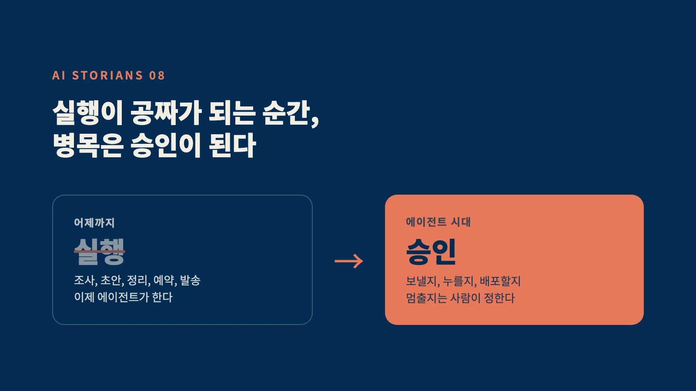
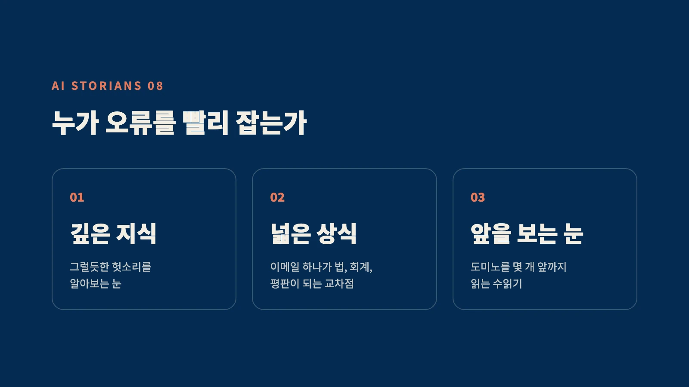

지난 3주간, 실리콘밸리에서 이상한 일이 벌어졌다.

메타가 자기 광고 지면을, 페이스북보다도 인스타그램보다도 먼저, 출시 열흘 된 신제품 하나에 내줬다.
자기 회사의 간판 앱들을 제치고.

이름은 뮤즈(Muse). 메타의 에이전트 AI다.

에이전트가 뭐냐고? 대신 해주는 AI다.
대화만 하는 챗봇이 아니라, 웹을 돌아다니고, 양식을 채우고, 이메일을 보내고, 여행을 예약하고, 결제까지 한다. 당신이 앱을 꺼도 혼자 일한다.

사실 이 게임은 꽤 전에 시작됐다.
오픈클로 같은 오픈소스 에이전트는 강력했지만, 직접 설치해야 하는 극소수의 장난감이었다.
클로드 코드는 개발자들의 세계를 갈아엎었지만, 개발자들만 썼다.
그록봇은 일반인도 쓰게 다듬었지만, 월 200달러였다.

뮤즈는 달랐다. 왓츠앱에서 친구에게 메시지 보내듯 쓰면 된다. 그리고 메타는 세계 최대의 배포망을 갖고 있다. 지난 화에서 말한 그대로다. 기능이 아니라 배포가 승부를 갈랐다. 뮤즈는 미국에서 가장 먼저 터졌고, 아직 출시 안 된 나라에선 VPN을 깔면서까지 쓴다는 후기가 올라온다.

그리고 바로 어제, 오픈AI가 데브데이에서 응수했다. 챗GPT 안에 상주하는 에이전트, 닷츠(Dots)다.

에이전트 전쟁이 열렸다.
이제 AI가 정말로, 뭐든지 대신 해주는 시대가 온다.

오늘 하고 싶은 얘기는, 그 반대쪽이다.

## 1. 그런데, 이상한 일이 하나 더 있다

뮤즈가 미국에서 뜨는 동안, 조용히 벌어진 사건이 있다.

아마존이 뮤즈를 차단했다.

에이전트가 아마존에 들어와 대신 쇼핑하는 것을, 약관 위반이라며 막아버린 거다.
쇼피파이는 반대로 문을 열었다. 그리고 이 차단과 개방이, 업계 전체의 논쟁이 됐다.

솔직히 말하면, 아마존의 차단은 안전보다 밥그릇에 가까워 보인다.
에이전트가 대신 쇼핑하면, 사람은 아마존의 광고도, 추천도 보지 않는다.
그래서 오히려 중요한 장면이다. 멈출 수 있는 힘은, 그 자체로 권력이 된다는 뜻이니까.

한 가지 더. 뮤즈를 만든 메타조차, 뮤즈를 그냥 풀어놓지 않았다.
뮤즈는 '보안 가상머신'이라는 격리된 방 안에서만 일한다. 에이전트를 만든 회사가, 에이전트를 가두는 장치부터 만든 거다.

보이는가.

자동화를 만드는 회사들이, 동시에 자동화를 막는 장치를 만들고 있다.
자동화를 당하는 회사들은, 막을 권리를 두고 싸우기 시작했다.

자동화가 발전할수록, 반-자동화가 발전한다.
이게 오늘의 주제다.

## 2. 엘리베이터를 대중화한 것은, 브레이크였다

이 구조는 처음이 아니다. 역사에 정확한 라임이 있다.

1854년, 뉴욕 세계박람회.
엘리샤 오티스라는 발명가가 군중 앞에서 목숨을 건 쇼를 한다.

높이 매달린 승강기 위에 올라가서, 도끼로 밧줄을 끊게 한 거다.

승강기는 추락하다가, 몇 뼘 만에 멈췄다.
오티스가 발명한 안전 브레이크가 작동한 거다.
그가 군중에게 외친 말이 기록에 남아 있다.

"모두 안전합니다, 여러분. 모두 안전합니다."

여기서 중요한 사실. 엘리베이터, 그러니까 물건을 끌어올리는 기술은 오티스 이전에도 있었다.
사람들이 안 탔을 뿐이다. 밧줄이 끊어지면 죽으니까.

오티스가 판 건 올라가는 기술이 아니었다.
멈추는 기술이었다.

그리고 그 멈추는 기술이, 마천루의 시대를 열었다. 브레이크가 생기고 나서야 사람들은 10층에, 50층에, 100층에 올라갔다. 오티스는 지금도 세계 최대 엘리베이터 회사다.

기억하라. 사람들은 올라가는 기계가 아니라, 멈출 수 있는 기계에 탄다.

에이전트도 똑같다.
내 이메일을, 내 카드를, 내 계정을 맡기는 순간, 에이전트는 승강기가 된다.
사람들이 정말로 묻는 질문은 "얼마나 잘하냐"가 아니다.
"잘못되면, 멈출 수 있냐"다.

## 3. 병목이 이동한다: 실행에서, 승인으로

이제 개인 얘기로 내려오자.

에이전트 시대의 일은 이렇게 바뀐다.
어제까지 당신이 하던 실행을, 에이전트가 한다. 조사, 초안, 정리, 예약, 발송.
실행의 값은 0을 향해 떨어진다.

그럼 인간의 일은 사라지는가. 아니다. 이동한다.

에이전트가 100개의 작업을 해오면, 누군가는 정해야 한다.
어떤 것을 내보내고, 어떤 것을 멈출지.
이 이메일을 진짜 보낼지. 이 결제를 진짜 누를지. 이 코드를 진짜 배포할지.

실행이 공짜가 되는 순간, 병목은 승인이 된다.

메신저 편에서 말했다. AI는 최종 서명하지 않는다고.
에이전트 시대에 그 문장은 더 무거워진다.
에이전트는 일을 대신할 수 있다. 하지만 책임을 대신할 수는 없다.

그래서 돈의 흐름도 바뀐다.

모두가 자동화를 팔 때, 돈은 멈추는 쪽에도 흐른다.
에이전트의 권한을 설계하는 사람. 에이전트의 사고를 막는 보안. 에이전트가 한 일을 검증하는 감사. 에이전트에게 어디까지 맡길지 정하는 규칙.

체스 편을 기억하는 독자라면 웃을 거다.
주머니 속 엔진이 세계 챔피언보다 강해지자, 대회장에 금속탐지기가 생겼다.
AI가 잘할수록, 검증의 값이 오른다. 같은 법칙이 지금 산업 전체에서 반복되고 있다.

결론: 자동화를 막을 수 있는 사람이 되어라

이 명령을 풀어보자.

하나. 멈춤 버튼을 쥔 사람이 되어라.

에이전트가 아무리 많아져도, "실행해도 된다"는 말은 인간이 한다.
당신의 조직에서 그 말을 하는 사람이 되어라.
결재란에 이름을 쓸 수 있는 사람. 그게 에이전트 시대의 상석이다.

그런데 여기에 함정이 하나 있다.

에이전트가 하루에 100개를 가져오면, 사람은 읽지 않고 승인하기 시작한다.
확인, 확인, 확인. 버튼을 누르는 손만 남는다.
진짜 위협은 AI가 당신을 대체하는 게 아니다. 당신이 AI의 도장이 되는 거다.

그래서 AI 시대의 인재상은 판단력이다.
도장을 찍는 사람이 아니라, 오류를 빨리 캐치하는 사람.

둘. 안전을 설계하는 사람이 되어라.

오티스는 엘리베이터를 발명하지 않았다. 브레이크를 발명했고, 그래서 시대를 소유했다.
에이전트 시대의 오티스들은 지금 만들어지고 있다.
권한 설계, 보안, 검증, 감사. 자동화가 클수록, 이 일들은 정확히 그만큼 커진다.
그리고 어느 자리에 검증이 필요하고, 어느 자리에 보안이 필요한지 알아채는 능력이 더욱 귀중해진다.

그럼, 누가 오류를 빨리 캐치하는가.
AI 시대에선, 이런 사람이 되어야 한다.

먼저, 그 분야를 깊이 아는 사람.
에이전트가 가져온 결과물이 진짜 맞는지, 그럴듯한 헛소리인지는 그 분야를 아는 사람 눈에만 보인다.
모르는 사람은 멈출 수 없다. 뭐가 이상한지 보이지 않으니까.
"AI가 다 아는데 공부는 왜 해"라는 말이 유행이다. 정반대다.
AI가 일을 대신할수록, 그 일에 대한 지식은 더 중요해진다.
실행하기 위한 지식에서, 판별하기 위한 지식으로. 쓰임이 바뀔 뿐이다.

다음은, 넓은 상식을 가진 사람.
에이전트는 분야를 가리지 않고 일을 벌인다. 이메일 하나가 법적 문제가 되고, 결제 하나가 회계가 되고, 포스팅 하나가 평판이 된다.
승인자는 그 교차점을 봐야 한다.
한 우물의 깊이에, 세상 전체의 넓이를 더한 사람이 멈춤 버튼을 쥔다.

마지막은, 앞을 볼 수 있는 사람.
멈출지 말지는 결국 예측이다. 이걸 실행하면, 다음에 무슨 일이 벌어지는가. 그 다음엔. 그 다음엔.
도미노를 몇 개 앞까지 볼 수 있는가.
체스 플레이어들이 수읽기라고 부르는, 바로 그 능력이다.

깊은 지식, 넓은 상식, 앞을 보는 눈.
이 셋을 가진 사람만이 멈출 수 있다.

그리고 기억하라. 멈출 수 있는 힘은 권력이 된다.
아마존은 그 힘을 밥그릇을 지키는 데 썼다.
우리가 되어야 할 사람은, 그 힘을 책임을 지는 데 쓰는 사람이다.
이 시리즈가 첫 화부터 반복해온 두 단어, 신뢰와 책임은 에이전트 시대에 이렇게 번역된다.
멈출 수 있는 사람만이, 맡길 수 있는 사람이 된다.

오늘 당신의 일에서 찾아보라.
마지막 승인이 어디에서 일어나는지. 그리고 지금 당신이, 그 자리에서 읽고 있는지 도장만 찍고 있는지.

에이전트는 일을 대신한다.
책임은, 대신하지 못한다.

AI 시대에서 이기고 싶다면, 자동화를 막을 수 있는 사람이 되어라.
Be the one who can say stop.

— 제이킴모건, ai storian

---

## Sources

- Meta Muse: 2026.9.8 출시, 왓츠앱 통합, 브라우징과 결제 대행, Muse Secure VM: [Meta 공식](https://about.fb.com/news/2026/09/introducing-muse-personal-ai-agent/), [TechCrunch 출시](https://techcrunch.com/2026/09/08/meta-debuts-its-muse-ai-agent-will-consumers-trust-it/) / 광고 우선 배정(출시 열흘 만에 자사 광고 지면 과반, 페이스북과 인스타 홍보보다 앞섬): [TechCrunch](https://techcrunch.com/2026/09/25/meta-is-putting-its-muscle-behind-muse-as-the-ai-app-takes-off/) / 아마존 차단(약관 위반)과 쇼피파이 개방: [CNBC](https://www.cnbc.com/2026/09/27/meta-muse-ai-personal-agent.html), [Forbes](https://www.forbes.com/sites/maureenkerr/2026/09/27/metas-muse-ai-agent-tests-who-controls-digital-distribution/)
- Grok Bot: 2026.8.11 출시, 월 $200(무료 없음, 얼리 베타): [Neowin](https://www.neowin.net/news/spacexai-launches-openclaw-style-grok-bot-that-can-work-across-apps-on-its-own/), [eesel 비교](https://www.eesel.ai/blog/grok-bot-vs-openclaw)
- OpenClaw: 오픈소스, 셀프호스팅: [비교 리뷰](https://www.kad8.com/ai/grok-bot-vs-openclaw-two-paradigms-for-ai-agent-platforms/)
- OpenAI Dots: 2026.9.29 데브데이 발표, 상주형 에이전트: [TechCrunch](https://techcrunch.com/2026/09/29/openai-launches-dots-its-bubbly-agentic-avatar/), [9to5Mac](https://9to5mac.com/2026/09/29/openai-teases-20-announcements-at-devday-watch-live/)
- 오티스 1854 뉴욕 수정궁 시연, "All safe, gentlemen, all safe": 역사 통설, 통용 사실

## 검증 노트 (발행 전)

- v2 교정 1 (팩트): 콜드오픈 "광고 지면을 주지 않았다"는 과장이었음. 보도 원문은 "자사 광고 지면 과반이 뮤즈, 페북과 인스타 홍보보다 앞섬" → "먼저 내줬다"로 정정. "미국이 넘어갔다" → "미국에서 가장 먼저 터졌다", "미국을 휩쓰는" → "미국에서 뜨는"으로 강도 하향
- v2 교정 2: 아마존 차단의 동기 = 본문에서 "안전보다 밥그릇에 가까워 보인다"로 해석임을 명시(단정 아님). 보도상 공식 사유는 약관 위반
- v2 구조: 결론 셋(책임) 삭제, 책임 콜백은 아마존 대비 문단으로 흡수 / "도장 찍는 사람의 함정" 반론 추가(하나 안) / 연대기 4행으로 압축 / 엔딩에서 오티스 문장 반복 삭제, 먼데이 액션을 "읽고 있는지 도장만 찍고 있는지" 자가진단으로 구체화
- 남은 확인: "바로 어제" = 9.29 데브데이, 발행일 밀리면 수정 / VPN 후기 소스 미확보(JK 관찰 기반, 헤지 유지) / 체스 편 미발행이면 금속탐지기와 수읽기 콜백 문구 수정 / 오티스 "세계 최대" 1회 확인
- 가운뎃점 없음, 낫표 없음, em-dash 없음(서명 제외), 독백체 확인
