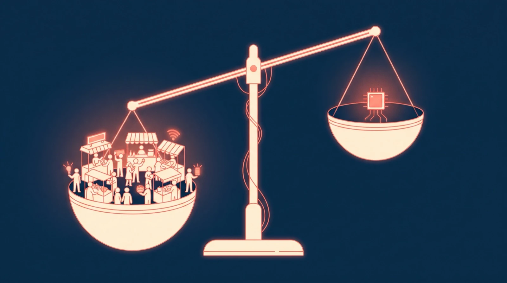
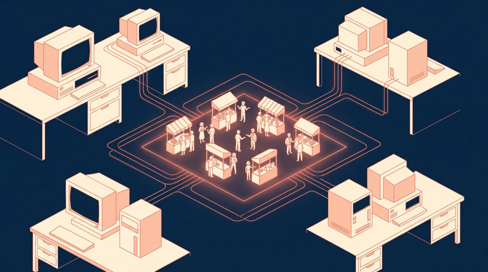
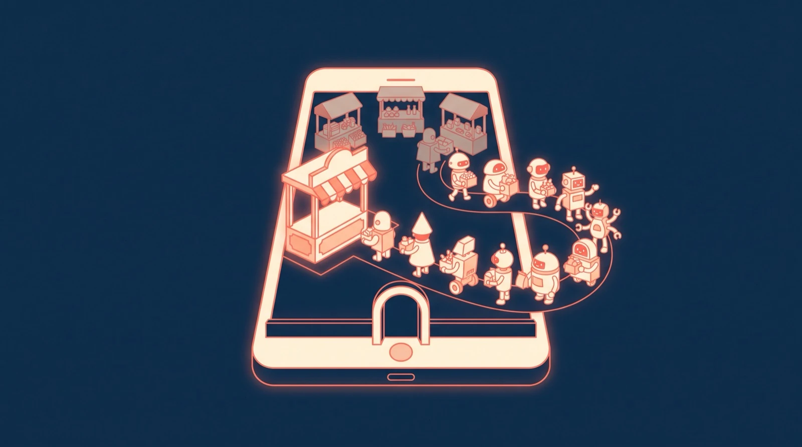
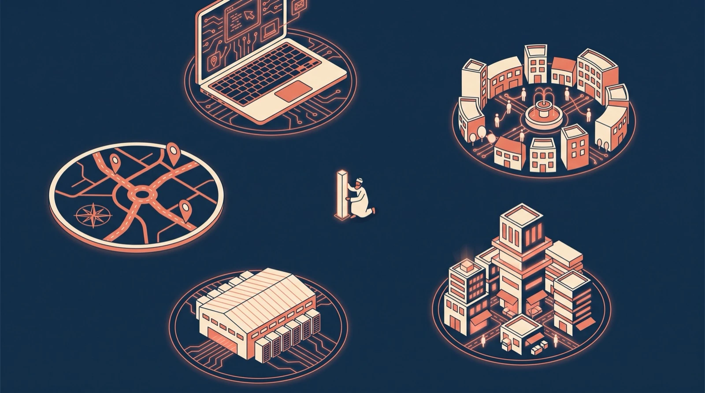

한 회사가 다른 회사에 한 해 200억 달러를 냈다.
아이폰의 사파리를 열었을 때, 검색창 뒤에 자기가 서 있게 해 달라는 값이었다.

구글이 애플에 내는 돈이다.
2022년 한 해에 약 200억 달러였다고 미국 법무부 재판을 다룬 보도들은 전한다.
사파리 검색 광고 수익의 36%가 애플 몫이라는 증언도 나왔다.

반대 방향으로 가는 돈도 있다.
올해 1월, 애플은 새 시리의 머리로 구글의 제미나이를 쓰겠다고 발표했다. 보도에 따르면 그 값은 한 해 약 10억 달러다.

하나는 장터의 자릿세다. 다른 하나는 세계에서 가장 똑똑한 축에 드는 물건, AI 모델의 값이다.
연도가 달라 정확한 비교는 아니다. 그래도 자릿수는 보인다. 대략 스무 배.

요즘 AI 뉴스는 매주 순위표를 바꾼다. 어느 모델이 시험에서 몇 점을 더 받았는지, 어느 회사가 1등을 되찾았는지.
그럼 1등 모델을 가진 회사가 결국 이기는 걸까.
돈은 그 순위표를 보고 움직이지 않는 것 같다. 순위표 밖의 자리, 사람이 매일 손을 대는 자리에 더 많은 돈이 붙는다.

지난 화 끝에서 다음은 기억 이야기라고 했다. 그 전에 먼저 봐야 할 자리가 있다.
AI가 강해질수록 값이 오르는 곳, 손님이 모이는 장터다.

## 1. 지금, 1등과 2등의 거리가 좁아졌다

제본스대로라면, 싸지면 사람은 더 쓴다. 더 쓰면, 장터를 찾는 발걸음도 는다.

AI는 정말 빠르게 싸지고 있다.
같은 수준의 답을 받는 값은 해마다 적게는 아홉 배, 많게는 수백 배씩 떨어졌다(에포크 AI).
2023년 3월에 100만 토큰당 37.5달러이던 답이, 2년 뒤엔 0.18달러가 됐다.

모델끼리의 거리도 가까워졌다.
스탠퍼드의 AI 인덱스는 올해 3월 기준으로 미국 최상위 모델이 중국 최상위 모델을 겨우 2.7% 앞선다고 적었다. 두 나라 모델은 2025년 초 이후 여러 차례 선두를 주고받았다. 점수로는 거의 닫힌 거리다.

물론 모든 거리가 줄어든 건 아니다. 가장 강한 오픈 웨이트 모델은 올해 들어 가장 강한 비공개 모델에 평균 넉 달쯤 뒤진다(에포크 AI). 맨 앞의 경쟁은 아직 뜨겁다.

다만 보통 사람이 하루에 하는 일, 메일을 다듬고 일정을 묻고 사진 속 글자를 읽게 하는 일에서, 그 넉 달을 느끼는 사람은 많지 않다.

장사꾼들의 물건이 비슷해지면 무엇이 승부를 가를까.

## 2. 과거, 기계를 판 쪽과 장터를 연 쪽

1980년, IBM은 개인용 컴퓨터를 만들기로 했다. 서둘렀다. 운영체제는 밖에서 구했다.

그 운영체제를 대 준 곳이 작은 회사 마이크로소프트였다. 마이크로소프트는 시애틀의 다른 회사에서 운영체제를 들여와 다듬은 뒤 IBM에 넘겼다.
그리고 계약에서 권리 하나를 놓지 않았다. IBM 말고 다른 회사에도 이 운영체제를 팔 수 있는 권리였다.

IBM PC가 나오자 비슷한 기계들이 쏟아졌다. IBM과 호환되는 컴퓨터를 여러 회사가 앞다퉈 내놓았다.
기계는 누구나 만드는 물건이 됐다. 그런데 켜면 뜨는 화면은 하나였다. 사람과 프로그램이 만나는 장터가 거기 열렸다.

1993년 1월, 마이크로소프트의 시가총액이 처음으로 IBM을 넘었다고 당시 보도는 전한다. 그날의 역전은 잠깐이었다. 그래도 방향은 그때 이미 정해져 있었다.

기계에는 IBM의 이름이 붙었다. 돈은 모든 기계에 같은 운영체제를 넣어 준 쪽으로 갔다.

## 3. 장터 주인이 지는 날도 있다

여기까지 읽으면 이런 반론이 나온다. 장터만 쥐면 다 이기나.

아니다. 장터 주인이 진 날도 분명히 있다.

2022년 11월, 챗GPT가 나왔다. 오픈AI에게는 운영체제도, 브라우저도, 검색창도 없었다. 세계에서 가장 큰 장터는 구글이 쥐고 있었다.
챗GPT는 두 달 만에 월 사용자 1억 명에 닿은 것으로 추정됐다(UBS). 손님들이 장터 밖 노점으로 몰려갔다.

반대 쪽의 장면도 있다.
윈도우를 켜면 엣지가, 엣지를 켜면 빙이 먼저 뜬다. 마이크로소프트의 장터에서 가장 좋은 자리다. 그래도 사람들은 주소창에 구글을 친다. 빙의 세계 검색 점유율은 가장 최근인 9월에도 5%를 조금 넘는다(스탯카운터).

두 장면을 겹치면 조건이 하나 보인다.
물건의 격차가 크면, 손님은 장터를 가리지 않고 좋은 물건을 찾아간다.
격차가 작으면, 손님은 늘 가던 장터에서 산다.

장터 주인이 왕이 되는 건, 물건끼리의 차이가 장터를 옮기는 귀찮음보다 작아지는 순간부터다.

## 4. 그리고 지금, 그 순간이 오고 있다

AI는 지금 그 순간 쪽으로 가고 있다.

챗GPT는 장터 없이 이겼고, 그다음 스스로 장터가 됐다. 올해 2월 오픈AI는 챗GPT 주간 사용자가 9억 명에 닿았다고 밝혔다. 이제 챗GPT를 여는 손가락의 습관 자체가 하나의 장터다.

구글은 반대 방향에서 온다. 검색과 안드로이드라는 장터 한가운데에 제미나이를 놓았다.
구글은 7월 실적 발표에서 제미나이 앱 월 사용자가 9억 5천만 명이라고 밝혔다.
먼저 달린 장사꾼을, 장터 주인이 따라붙고 있다.

그리고 애플이 있다.
애플은 자기 모델로 승부하는 대신, 남의 모델을 빌려 왔다. 제미나이 계약은 독점이 아니라고 보도됐고, 오픈AI와의 계약은 그대로 둔다고 애플은 CNBC에 밝혔다.
물건은 빌려 오고, 장터는 쥔다.
장사꾼은 바꿀 수 있다. 장터는 바뀌지 않는다.

Distribution is king. 실리콘밸리에서 오래된 이 말이, AI 시대에 가장 비싼 값으로 다시 확인되고 있다.

법원도 이 구도를 바꾸지 않았다. 2025년 9월, 미국 연방지방법원은 구글이 자릿세를 계속 낼 수 있다고 판단했다. 다만 독점으로 묶는 건 막았고, 기본값을 해마다 바꿀 수 있게 했다. 이 판단은 항소심이 진행 중이다.
장터의 좋은 자리는 사라지지 않는다. 해마다 다시 경매에 붙을 뿐이다.

## 5. 장터 주인은 다섯이다

지금 AI 시대의 장터 주인을 꼽으면 다섯이다.

애플은 하드웨어라는 장터를 쥐었다. 주머니 속 아이폰부터 손목 위 워치까지, 활성 기기가 25억 대를 넘는다(올해 1월 발표).
메타는 사람이 모이는 장터를 쥐었다. 페이스북, 인스타그램, 왓츠앱 가운데 하나를 매일 여는 사람이 36억 명이다(6월 평균).
마이크로소프트는 일터라는 장터를 쥐었다. 회사들이 돈을 내고 쓰는 마이크로소프트 365 좌석이 4억 5천만 석을 넘는다고 보도됐다.
아마존은 장보기와 서버, 두 장터를 쥐었다. 쇼핑몰, 그리고 AWS. AWS는 2분기에만 422억 달러를 벌었고, 1년 전보다 37% 커졌다.

그리고 구글. 조금 애매한, 올인원이다.
검색, 안드로이드, 크롬, 유튜브, 지메일, 구글 드라이브, 구글 시트, 그리고 구글 지도.
길을 찾을 때도, 메일을 열 때도, 숫자를 정리할 때도, 우리는 하루에 몇 번씩 구글의 장터를 지나간다.

이 다섯에게는 공통점이 넷 있다.

첫째, 자체 모델이 있다. 애플 파운데이션 모델, 메타 슈퍼인텔리전스 랩스의 모델, 마이크로소프트의 MAI, 아마존의 노바, 구글의 제미나이.
애플은 다음 세대 모델을 제미나이 위에 짓기로 했다. 그래도 그건 약점이라기보다, 직접 만들지 골라 쓸지를 스스로 정할 수 있는 힘에 가깝다.

둘째, 자체 칩이 있다. 애플 실리콘, 메타의 MTIA, 마이크로소프트의 마이아, 아마존의 트레이니엄, 구글의 TPU.

셋째, 그걸 뿌릴 장터가 있다. 위에 적은 그대로다.

넷째, 돈이 있다. 6월 말 기준 현금과 유가증권이 알파벳 2,425억, 애플 1,465억, 아마존 1,230억, 메타 903억, 마이크로소프트 768억 달러다. 다섯을 합치면 6,800억 달러에 가깝다. 알파벳은 상반기에 채권과 주식으로 돈을 모아 그 숫자가 반년 새 두 배가 됐다.

물건을 직접 만들고, 물건을 만들 기계도 직접 만들고, 손님이 모이는 장터가 있고, 판을 키울 돈까지 있다.
장사꾼 혼자서는 이 넷을 다 갖기 어렵다.

맨 앞의 장사꾼, 오픈AI를 보자. 모델은 맨 앞이다. 그런데 칩은 브로드컴과 함께 만드는 중이고, 기기는 내놓겠다고 예고한 단계이고, 큰돈은 투자 약정으로 들어와 있다고 보도됐다.
장사꾼이 장터를 짓고 있다. 그 공사가 끝나기 전까지, 장터 주인 다섯은 기다려 주지 않는다.

## 6. 미래, 순위표 옆을 본다

그럼 앞으로 무슨 일이 일어날까.

나는 이렇게 본다. 모델은 계속 좋아진다. 그리고 계속 싸진다. 그럴수록 사람들은 모델 이름을 덜 따지게 된다.
택시를 부를 때 어느 회사 택시인지 묻는 사람은 드물다. 늘 쓰던 앱을 연다.
그때 값을 받는 쪽은 차를 가진 쪽보다, 손님과 차를 이어 주는 장터다.

이건 내 판단이다. 맨 앞의 넉 달 격차가 다시 벌어지거나, 챗GPT처럼 완전히 새로운 것이 나오면 손님들은 또 장터 밖으로 나갈 수 있다.

그래서 이 연재는 순위표 옆을 본다.
싸질수록 더 쓴다. 더 쓸수록 장터를 찾는 발걸음이 는다.
그리고 2025년부터 그 장터의 좋은 자리는 해마다 다시 팔린다.
발걸음이 느는 장터를 쥐고, 해마다 자릿세를 다시 매길 수 있는 쪽. 남들이 장사꾼의 순위를 볼 때, 나는 장터 주인을 본다.

우리 이야기로 오자.
내일 휴대폰을 열면 5분만 써 보자. 기본 검색이 무엇인지, 기본 어시스턴트가 무엇인지, 기본 브라우저가 무엇인지.
내가 고른 것인지, 처음부터 거기 있던 것인지.
내가 그 AI를 쓰는 이유가, 일이 잘돼서인지 그냥 거기 있어서인지.

그 답이 대부분 "거기 있어서"라면, 장터 주인이 왜 장사꾼보다 많이 버는지 이미 알게 된 것이다.

오늘은 이 문장만 가져가라.

애플은 물건 값으로 한 해 10억 달러를 낸다. 자릿세로는 200억 달러를 받아 왔다.

AI 시대에서 이기고 싶다면, 가장 똑똑한 장사꾼보다 장터를 쥔 쪽을 보라.
Models are rented. Marketplaces are owned.

- 제이킴모건, ai storian
