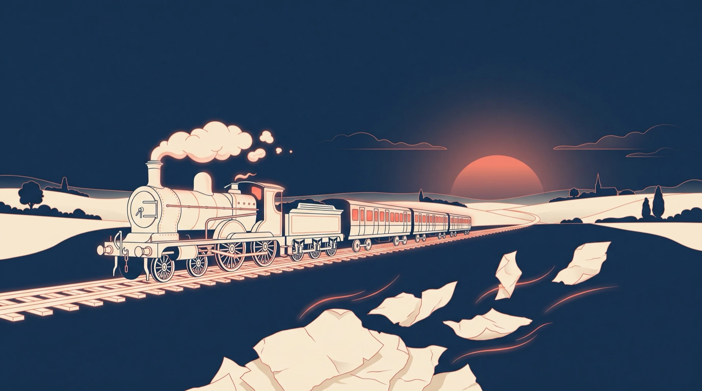
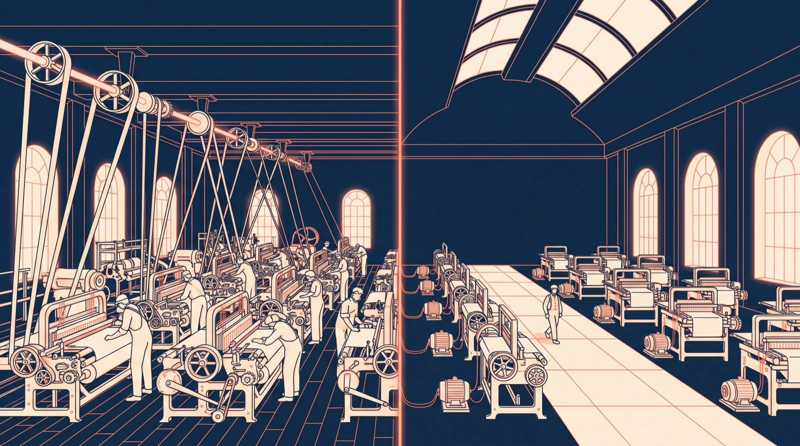
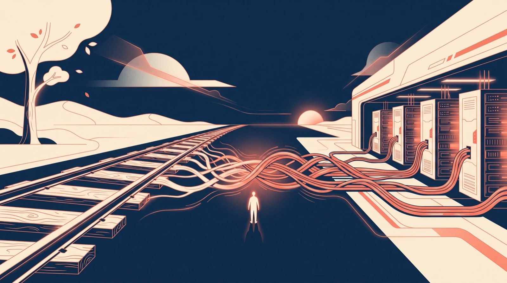

1846년, 영국 의회는 새 철도 노선 4,538마일을 승인했다.
4년 뒤, 새로 승인된 노선은 8마일이었다.

그 사이에 무슨 일이 있었나.

1847년, 영국은 한 해 국내총생산의 7.3%를 철도에 썼다. 군대보다 기차에 두 배 넘게 쓴 나라였다.
투자자들은 2,400마일 남짓이던 철도망이 2만, 3만 마일로 커질 거라고 봤다.

그리고 무너졌다.

1850년 말까지 영국과 아일랜드의 철도에 들어간 돈은 당시 국내총생산의 거의 절반이었다.
그 가운데 약 3분의 1이 투자자의 손실로 사라진 것으로 추정된다(앤드루 오들리즈코, 미네소타대).

여기까지는 흔한 거품 이야기다.
그런데 같은 시기에 다른 숫자가 하나 더 있다.

실제로 개통된 선로는 주가가 바닥을 기던 1850년에도 6,621마일로 늘었고, 1860년에는 1만 마일을 넘었다.
돈이 무너지는 동안에도, 선로는 깔리고 있었다.

오들리즈코의 정리는 이렇다. 주주들은 크게 잃었다. 그런데 파산한 노선은 거의 없었고, 거의 모두 계속 달렸다. 사회 전체가 얻은 것이 주주가 잃은 것보다 컸다는 논증이 설득력 있다고 그는 쓴다.

주주는 잃었다. 선로는 남았다.

투자자들이 꿈꾼 2만, 3만 마일은 어떻게 됐을까.
영국과 아일랜드의 철도는 1920년대 초에 약 2만 4,000마일로 정점을 찍었다.
꿈의 크기는 거의 맞았다. 거기까지 가는 데 70년 넘게 걸렸을 뿐이다.

방향은 맞았고, 속도가 틀렸다.

요즘 AI 버블이라는 말을 하루에도 몇 번씩 본다.
빅테크가 AI에 사상 최대의 돈을 붓고 있다는 기사 바로 옆에, 거품이 곧 터진다는 기사가 붙는다. 그 사이 어딘가에 내 연금과 내 일자리가 끼어 있다.

나도 그 기사를 읽는다. 그리고 매번 같은 질문에서 멈춘다. 거품이냐, 아니냐.
1847년의 영국은 그 질문이 반쪽짜리라는 걸 보여 준다.

이 연재, AI 시대를 읽는 투자는 그 질문을 바꿔 보려고 시작한다.
오늘은 그 첫 장이다. 과거에서 시작해, 지금으로 오고, 미래를 물어보겠다.

## 1. 싸지면, 사람은 더 쓴다

1865년, 영국의 경제학자 윌리엄 스탠리 제본스가 책 한 권을 냈다. 제목은 석탄 문제(The Coal Question).

그때 영국을 움직이던 건 석탄과 증기기관이었다. 증기기관은 개량될 때마다 석탄을 덜 먹었다. 제본스는 증기기관의 역사 전체가 절약의 역사라고 썼다.

상식대로라면 이야기는 여기서 끝난다. 기계가 석탄을 덜 먹으면, 나라도 석탄을 덜 쓴다.

제본스는 정반대라고 썼다.

"It is wholly a confusion of ideas to suppose that the economical use of fuel is equivalent to a diminished consumption. The very contrary is the truth."
연료를 아껴 쓰는 것이 덜 쓰는 것과 같다고 생각하는 건 완전한 착각이다. 진실은 정반대다.

연료를 덜 먹는 기계는 돌리는 값이 싸다. 싸면 더 많은 공장이 기계를 들인다. 예전엔 수지가 안 맞던 일에도 기계가 들어간다.
한 대가 먹는 석탄은 줄어도, 기계의 수가 그보다 빨리 는다.

숫자가 그 말을 따라갔다.
영국의 석탄 생산은 1854년부터 1913년까지, 60년이 채 안 되는 사이에 네 배 넘게 늘었다(NBER 통계).

철도도 이 이야기에 끼어 있다.
철도 전의 석탄은 무거웠다. 오들리즈코는 길이 좋은 곳에서도 탄광 입구에서 12마일만 옮기면 석탄 값이 두 배가 됐다고 적는다.
선로가 깔리자 석탄은 멀리까지 싸게 갈 수 있게 됐다. 나는 이 장면을 이렇게 읽는다. 거품이 남긴 선로 위로, 제본스의 석탄이 달렸다.

하나는 짚고 가자. 제본스는 거품 다음 차례로 오는 단계가 아니다. 거품은 한 번 터지고, 제본스는 늘 바닥에 깔려 있다.

## 2. 같은 노래가 다시 들린다

150년쯤 지나, 미국에서 같은 노래가 다시 들렸다.

1990년대 말에서 2000년까지, 인터넷 트래픽이 석 달마다 두 배가 된다는 말이 돌았다. 오들리즈코는 이 말을 부풀린 숫자로 봤다. 통신 회사들은 그 숫자를 믿고 광케이블을 묻었다.

1997년 말부터 2001년 말까지, 미국의 광섬유 전송 용량은 약 500배가 됐다. 같은 기간 실제 수요는 약 4배 늘었다(오들리즈코).

500배 대 4배.
거품은 터졌다. 1847년처럼, 돈을 댄 사람들이 값을 냈다.

그리고 1850년처럼, 망은 남았다.
땅에 묻힌 케이블은 어디로 가지 않는다. 남은 망 위로 몇 년 뒤 영상이 흘렀고, 스트리밍이 흘렀다. 우리가 밤마다 켜는 그 화면이, 거품이 남긴 케이블 위를 지나간다.

전기는 조금 다른 교훈을 남겼다.
경제사학자 폴 데이비드는 1990년 논문에서 이렇게 봤다. 공장들은 전동기를 달았지만, 기존의 축과 벨트에 전동기를 이어 붙이는 식이어서 생산성은 오래 제자리였다. 멀쩡한 공장을 헐고 새로 짓는 게 수지가 안 맞았기 때문이다. 기계마다 모터를 달고 단층 공장으로 배치를 새로 짠 뒤에야 효과가 났다. 첫 중앙발전소가 문을 연 지 약 40년 뒤, 1920년대 초의 일이다.

기술을 사는 건 하루면 된다. 일하는 방식을 다시 짜는 데는 수십 년이 걸린다.

장면들을 겹치면 하나의 모양이 보인다.
돈이 먼저 도착한다. 먼저 도착한 돈은 자주 잃는다. 그 돈이 깔아 놓은 것은 남는다. 그 사이 내내, 싸진 것은 더 많이 쓰인다. 그리고 삶은, 한참 뒤에 바뀐다.

## 3. 그리고 지금, AI

2025년 1월, 중국의 딥시크가 적은 비용으로 만들었다는 AI 모델 R1을 내놓았다. 일주일 뒤 월요일, 시장이 흔들렸다. AI를 이렇게 싸게 만들 수 있다면, 그 많은 칩과 데이터센터는 다 무엇이냐고.

그 전날 밤, 마이크로소프트 CEO 사티아 나델라가 짧은 글을 올렸다.
"Jevons paradox strikes again!"
제본스의 역설이 다시 왔다는 말이다. AI가 더 효율적이고 쉬워질수록 쓰임은 치솟을 것이고, 아무리 써도 모자란 물건이 될 거라는 말이 뒤따랐다.

160년 전 석탄 이야기를, AI 회사의 CEO가 꺼낸 것이다.

지금 숫자는 그 말 쪽으로 기울어 있다.
같은 수준의 답을 받는 값, 그러니까 토큰의 값은 해마다 크게 떨어지고 있다. 그런데 쓰는 양도 무섭게 는다.
구글은 올해 5월 개발자 행사에서, 자사 제품 전체가 한 달에 처리하는 토큰이 1년 새 일곱 배로 늘었다고 밝혔다.

싸지자, 더 쓴다.

그리고 이번에도 돈이 먼저 도착했다. 1847년의 영국이 철도에 그랬듯, 빅테크는 데이터센터와 칩에 돈을 붓고 있다.

다만 아직 닫히지 않은 계산이 있다.
값이 떨어지는 속도와 쓰는 양이 느는 속도 중 어느 쪽이 빠른지는, 이 숫자들만으로 알 수 없다. 그러니 전체 지출이 늘었는지도 아직 모른다. 구글의 숫자도 구글 제품 전체의 처리량이지, 누군가 돈을 내고 쓴 양이 아니다.

그래서 AI에서 제본스가 이미 증명됐다고 말하면, 과장이다.
지금 보이는 건 모양이지, 증명이 아니다.

## 4. 이번엔 다르다는 말

이쯤에서 반론이 하나 나온다.
철도 선로는 백 년 넘게 쓰였다. 광케이블도 수십 년을 간다. 그런데 GPU는 몇 년이면 낡는다. 이번 거품이 터지면, 남는 게 훨씬 적을 수 있다.
그리고 제본스가 늘 맞는 것도 아니다. 싸진다고 무엇이든 더 쓰지는 않는다.

그런데 첫 번째 반론은 요즘 흔들리고 있다.

2020년에 나온 세대의 칩이 지금도 일한다.
미국의 AI 클라우드 회사 코어위브의 CEO는 올해 8월, 2020년 세대 칩을 2029년까지 제값에 빌려주는 계약을 맺었다고 말했다(CNBC). 아홉 해를 일하는 칩이다.
마이크로소프트와 구글은 서버와 GPU를 6년에 걸쳐 나눠 상각한다. 마이크로소프트의 CFO는 지금 사는 GPU 대부분이 쓸 수 있는 기간 대부분에 걸쳐 이미 계약돼 있다고 말했다.

몇 해 지난 GPU도 계속 쓰인다는 증거가 쌓이고 있다.

반대 목소리도 있다. 아마존은 일부 서버의 수명을 6년에서 5년으로 줄였고, 마이클 버리는 빅테크가 칩의 수명을 길게 잡아 이익을 부풀린다고 본다.
그리고 두 번째 반론, 제본스가 늘 맞지는 않는다는 말은 그대로 남는다.

그래서 이 연재는 이 순서를 법칙이라고 부르지 않는다. 패턴이라고 부른다.
사례는 몇 개뿐이고, 매번 조금씩 달랐다. 전기는 붕괴보다 지연이 더 큰 이야기였다. 광케이블은 공급이 수요를 백 배 넘게 앞질렀다. 500배 대 4배에서 나온 숫자다.

패턴이 쓸모 있는 건 답을 주기 때문이 아니다. 질문을 바꿔 주기 때문이다.

거품이냐 아니냐는, 맞혀도 손에 남는 게 적은 질문이다. 언제 터지는지까지 맞혀야 의미가 있고, 그건 아무도 못 한다.
더 좋은 질문이 있다. 터지면, 무엇이 남는가.

칩도 생각보다 오래 일한다. 그리고 칩을 돌리려고 끌어온 전력망, 데이터센터를 지은 땅, 사람들이 AI와 일하며 몸에 익힌 방식은 그보다 더 오래 남을 수 있다.
이건 내 해석이다. 1850년의 선로처럼 남을지는, 지금 누구도 장담 못 한다.

하나 더 있다.
1847년에 돈을 댄 사람과, 1860년에 그 선로로 득을 본 사람은 같은 사람이 아니었다. 값을 낸 쪽과 얻은 쪽이 갈렸다.
나는 이번에도 둘이 다를 거라고 본다.
궁금한 건, 이번엔 우리가 어느 쪽에 서 있느냐다.

## 5. 이 연재가 보는 세 가지

오늘 한 일을 돌아보면 이렇다. 1847년과 1865년과 2001년을 봤고, 2025년과 올해를 봤고, 터지면 무엇이 남을지를 물었다.
이 연재는 매번 이 세 가지를 본다.

지금 무슨 일이 일어나는가.
과거엔 무슨 일이 일어났는가.
미래엔 무슨 일이 일어날까.

지금만 보면 뉴스에 휩쓸린다. 과거만 보면 이번엔 다르다는 말에 진다. 미래만 보면 점쟁이가 된다.
셋을 겹쳐 볼 때, 남들이 아직 잇지 못한 점이 이어진다. 나는 그걸 투자의 알파라고 부른다.

다음 화는 지금에서 출발한다.
AI가 오래 생각할수록, 돈은 계산하는 칩 바로 옆의 부품 하나로 몰리고 있다. 기억이다.
지능은 싸지는데, 기억은 비싸진다. 그 영수증이 누구에게 가는지 따라가 보겠다.

내일 AI 버블 기사를 보면, 하나만 다르게 해 보자.
거품이냐고 묻기 전에, 터지면 무엇이 남느냐고 먼저 물어보자. 그리고 그 남는 것 위에 내 일이 서 있는지도.

오늘은 이 문장만 가져가라.

1847년의 주주는 잃었다. 선로는 남았다.

AI 시대에서 이기고 싶다면, 돈이 남기는 것을 읽어라.
Follow the money, then ask what stays.

— 제이킴모건, ai storian
