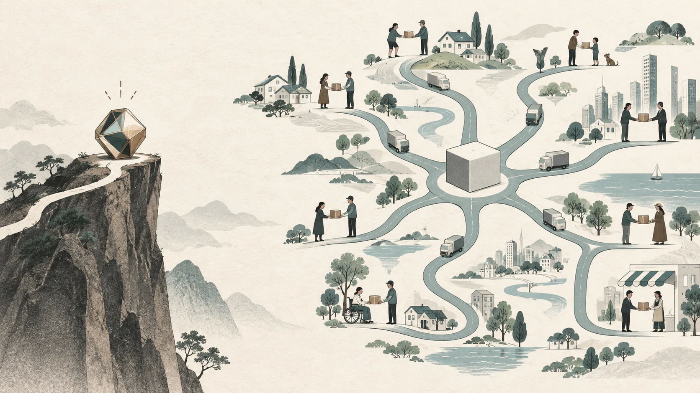
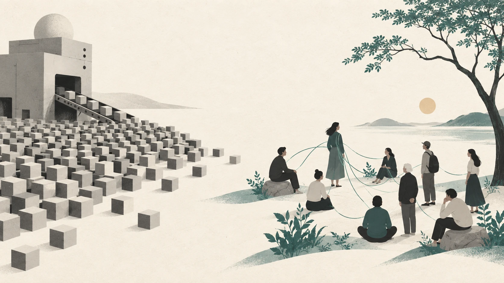

슬랙이 등장했다. 실리콘밸리는 열광했다. 슬랙을 알고, 슬랙을 쓴다는 것 자체가 일 잘하는 사람의 증명이던 시절이 있었다.

2016년 11월 2일, 마이크로소프트가 대항마 '팀즈'를 발표한다. 그날 슬랙은 뉴욕타임스에 전면광고를 냈다.

"Dear Microsoft. 오늘의 발표를 축하한다. 경쟁자가 생겨서, 진심으로 설렌다."

여유가 넘쳤다. 우리 제품이 더 좋다는 확신이었다. 틀린 말도 아니었을 거다.

10년이 지났다.

팀즈의 이용자는 3억 명이 넘는다(MS 발표). 슬랙은 2020년, 세일즈포스에 팔렸다. 더 이상 독립 회사도 아니다.

제품은 슬랙이 이겼을지도 모른다. 그런데 전쟁은, 제품이 하는 게 아니었다.

마이크로소프트는 팀즈를 오피스에 끼워서 뿌렸다. 슬랙은 다운로드를 설득해야 했고, 팀즈는 이미 깔려 있었다.

오늘은 불편한 이야기를 하겠다. AI 시대의 부익부 빈익빈. 플랫폼이 승리하는 구조에 대한 이야기다.

모든 것이 싸지고 있다

이 시리즈에서 계속 말해왔다. 지능이 공짜가 되어가는 시대라고.

이제 목록을 늘려보자.

지능은 싸진다. 어떤 질문이든 딸깍이면 답이 나온다. 정보도 싸진다. 액세스는 공짜에 가깝다. 그리고 이제, 만드는 능력까지 싸지고 있다.

'바이브 코딩'이라는 말이 생겼다. 코드를 몰라도, AI에게 말로 시켜서 앱을 만드는 것. 이 말을 만든 사람이 다름 아닌 오픈AI 창립 멤버이자 테슬라 AI 총괄 출신, 안드레 카파시다. 코딩의 최전선에 있던 사람이 "이제 코딩은 말로 한다"고 선언한 거다.

누구나 신기한 걸 만들 수 있는 시대. 아이디어만 있으면 실행의 벽이 무너지는 시대.

여기까지는 아름다운 이야기다. 그런데 이 동전에는 뒷면이 있다.

내가 쉽게 만들 수 있다는 건, 남도 쉽게 베낄 수 있다는 뜻이다.

예전에는 솔루션 자체가 가치였다. 코딩이, 개발력이, 구현이 해자였다. 이제 그 해자에 물이 빠지고 있다. 만들기 쉬워질수록, 만들 수 있는 것의 가치는 떨어진다.

그럼 뭐가 남는가.

만드는 능력이 흔해지면, 나르는 능력이 귀해진다. Distribution. 배포다.

역사는 이미 답을 보여줬다

증거는 AI 시대 전에 이미 쌓여 있다.

사라지는 메시지, 24시간 스토리. 이 포맷의 원조는 스냅챗이다. 2013년에 만들었다. 2016년 8월, 인스타그램이 이걸 그대로 베꼈다. 이름조차 안 바꿨다. 똑같이 '스토리'였다.

염치가 없었던 게 아니다. 오히려 당당했다. 인스타그램 CEO 케빈 시스트롬은 기자들 앞에서 이렇게 인정했다.

"스냅챗이 모든 공을 가져 마땅하다. 하지만 이건 누가 발명했느냐의 문제가 아니다. 이건 포맷의 문제고, 그 포맷을 어떤 네트워크에 얹느냐의 문제다."

베낀 당사자의 입에서 나온, 이 시대의 가장 정직한 자백이다. 발명이 아니라, 네트워크다.

결과는 어땠나.

스냅챗은 스토리 이용자 1억 명을 모으는 데 4년이 걸렸다. 인스타그램은, 2달 걸렸다.

당시 인스타그램의 하루 이용자는 3억 명. 기능은 복제할 수 있었지만, 스냅챗은 그 3억 명의 배포망을 복제할 수 없었다. 지금 스토리는 인스타그램에서 떼려야 뗄 수 없는 기능이 됐고, 원조가 누구였는지는 아무도 묻지 않는다.

기능은 복제된다. 배포망은 복제되지 않는다.

슬랙과 팀즈도, 스냅챗과 인스타그램도, 같은 문장의 다른 예문일 뿐이다.

AI는 이 게임을 잔인하게 가속한다

"그건 빅테크들 얘기잖아"라고 생각할 수 있다. 그럼 이 숫자 하나를 보자. 43일.

2022년 10월, 재스퍼(Jasper)라는 스타트업이 1억 2,500만 달러를 투자받았다. 기업가치 15억 달러. AI로 마케팅 문구를 써주는, 당시 가장 잘나가던 AI 스타트업이었다.

그리고 정확히 43일 뒤, OpenAI가 챗GPT를 무료로 풀었다.

재스퍼가 돈 받고 팔던 것의 상당 부분을, 챗GPT는 공짜로 했다. 그 뒤로 재스퍼는 매출이 반토막 나고, 네 차례 감원을 겪었다(업계 보도 종합). 유니콘에서 경고 사례가 되는 데, 채 1년이 안 걸렸다.

이게 새로운 속도다.

예전에는 대기업이 스타트업의 기능을 베끼는 데 수년이 걸렸다. 그 사이에 스타트업은 도망갈 시간이 있었다. 이제 AI가 개발 속도를 끌어올리면서, 그 시간이 몇 달, 몇 주로 줄고 있다. 실리콘밸리에는 이미 관전 문화가 생겼다. OpenAI가 신기능을 발표하는 날마다, "이번엔 어떤 스타트업들이 사라졌나"를 세는 거다.

구조를 보자. 잔인하다.

아이디어 검증은 스타트업이 한다. 시장의 반응을 온몸으로 확인해준다. 그 아이디어가 진짜라는 게 증명되는 순간, 플랫폼이 들어온다. 같은 기능을, 더 빠르게 만들어서, 수억 명의 배포망에 얹는다.

스타트업은 시장조사를 해주고, 플랫폼이 계산서를 가져간다.

지능이 싸질수록, 기능이 흔해질수록, 배포망을 가진 자가 전부를 가진다. 플랫폼은 갈수록 갑이 되고, 솔직히 말하면, 깡패가 되어간다.

부익부 빈익빈. 이게 AI 시대의 기본 물리법칙이다.

흔해지는 것과 귀해지는 것

눈치챘겠지만, 이 구조는 이 시리즈에서 계속 본 것이다.

호스트 편에서 말했다. 참가자는 명함을 얻고, 호스트는 명단을 얻는다고. 개인의 배포망이 명단이라면, 기업의 배포망이 플랫폼이다.

AI 시대의 법칙은 개인에게나 기업에게나 하나로 통한다.

흔해지는 것: 지능, 정보, 기능, 콘텐츠, 코드. 귀해지는 것: 그것을 실어 나를 길. 관계, 명단, 채널, 배포망.

만드는 자의 시대가 저물고, 나르는 자의 시대가 오고 있다.

결론: 그럼, 우리는 다 진 건가

여기까지 읽으면 우울해진다. 플랫폼이 다 이기는 게임이라면, 스타트업은, 개인은, 뭘 해야 하나. 아이디어가 있어도 어차피 베껴질 텐데, 시작할 이유가 있나.

있다.

슬랙이 진 전쟁에서도, 스냅챗이 뺏긴 싸움에서도, 살아남은 자들의 공통점이 있다. 플랫폼이 베낄 수 없는 것을 가진 쪽이다.

기능은 베껴져도 베껴지지 않는 것들. 고유의 세계관과 철학. 디자인의 매력. 좁지만 깊은 팬덤. 대기업이 흉내 낼 수 없는 속도. 그리고 앞으로 가장 뜨거워질 전장, 아이디어의 소유권. 특허와 IP의 전쟁.

이 시리즈를 읽어온 독자라면 익숙할 거다. 서사, 전통, 신뢰, 상징. 우리가 계속 말해온 그것들이, 기업의 언어로는 이렇게 번역된다.

플랫폼의 시대에 살아남는 법. 아니, 플랫폼 옆에서 빛나는 법. 그 얘기는 다음 화에서 제대로 하겠다. (스타트업이 살아남는 법에 관한 내용은 다음 화에서)

오늘은 이 문장만 가져가라.

슬랙은 더 좋은 제품을 만들었다. 마이크로소프트는, 더 넓은 길을 갖고 있었다.

AI 시대에 아이디어는 흔해지고, 기능은 복제된다. 당신이 쌓아야 할 것은 기능이 아니라, 길이다.

AI 시대에서 이기고 싶다면, 길을 소유하라. Distribution is king.

— 제이킴모건, ai storian
