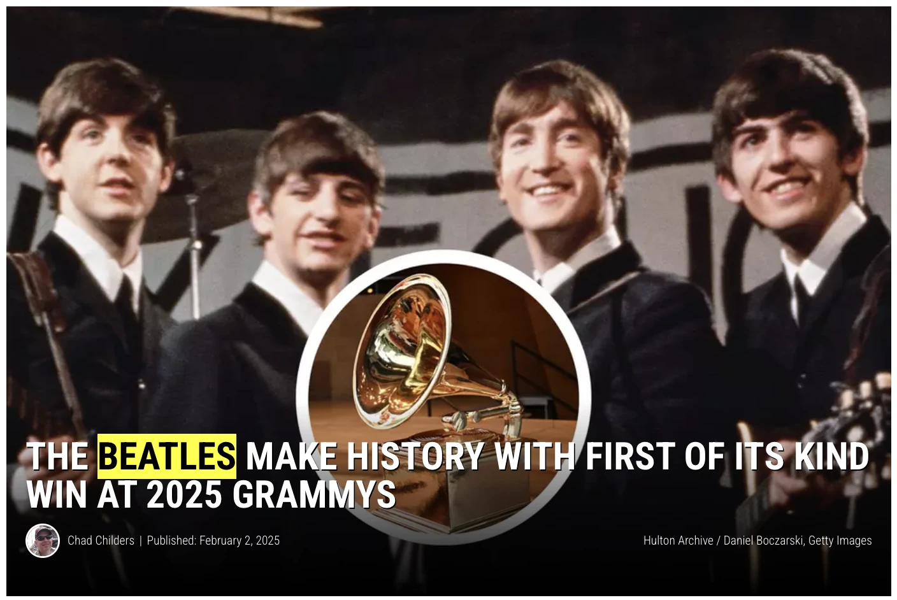
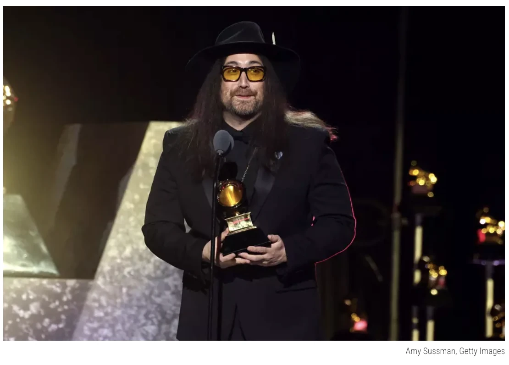

2025년 2월, 그래미 시상식. Best Rock Performance 수상자가 호명된다.

비틀즈.

존 레논이 세상을 떠난 지 45년. 밴드가 해체된 지 55년.

비틀즈가, 신곡으로, 그래미를 탔다.

상을 받은건 2025년이지만, 이 노래는 약 50년 전에 녹음된 노래였다.

1977년 어느 밤, 레논이 집에서 카세트에 데모를 녹음했다.

피아노 소리에 목소리가 묻혀서, 남은 멤버들도 완성을 포기했던 테이프였다.

그리고 무려 반세기가 지난 뒤, AI가 그 테이프에서 레논의 목소리를 분리해냈고, 폴과 링고가 곡을 완성했다. 곡의 제목은 "Now and Then". 그래미 역사상 최초의 AI 참여곡 수상이었다.

폴 매카트니는 말했다. AI가 만들어낸 건 아무것도 없다고. 전부 진짜라고.

맞는 말이다. 그리고 그게 이 이야기의 핵심이다.

AI는 레논을 되살린 게 아니다. 레논이 남긴 과거를 되살린거다.

1977년의 그 밤, 레논이 녹음 버튼을 누르지 않았다면 이 곡은 세상에 존재할 수 없다.

세상에서 가장 뛰어난 AI를 데려와도, 없는 기록은 꺼낼 수 없으니까.

기록을 남긴 사람은, 현대로, 미래로 이어질 수 있다.

그리고 이건 비틀즈만의 얘기가 아니다. 우리는 매일, 우리의 AI에게 데모 테이프를 건네고 있다.

그 얘기를 하기 전에, 실험 하나만 하자.

지금 챗GPT를 열고 물어보라. Incognito mode나 stranger 모드로 하는게 더 정확할 수도 있다.

"(당신의 이름)이 누구야?"

"해당 인물에 대한 정보를 찾을 수 없습니다."

"연예인(동명이인)을 말하는 건가요?"

XXX에 연예인, 기업인의 이름을 넣으면 LLM은 줄줄 대답한다. 회사, 철학, 어록. 위키를 뒤지고, 인터넷에 있던 기록들을 뒤지고, 정리해서 답을 준다.

당신과 "이들"의 차이는 능력이 아니다. AI가 읽을 수 있는 곳에, 서사(과거)가 존재하느냐의 차이다.

이것이 AI 시대의 잔인한 진실이다. AI가 모르는 서사(과거)는, 존재하지 않는다.

당신의 서랍에는 졸업장이 있다. 액자에는 상장이 있다. 어딘가에 자격증이 있다.

이것은 전부 사람에게 보여주려고 만든 여러분의 서사다.

그런데 문제가 생겼다. 이젠 심사관이 바뀌었다.

심사관이 바뀌었다

지난 화에서 말했다. AI 시대는 과거를 심사하는 시대라고.

이번 화의 질문은 이거다. 그 과거를, 누가 읽는가?

숫자부터 보자.

기업의 83%가 AI로 이력서를 먼저 읽는다(미 인사관리협회 SHRM 조사). 당신의 이력서를 처음 읽는 건, 이제 사람이 아니다.

소비자의 절반 이상이 검색창 대신 AI에게 추천을 묻는다(업계 설문).

식당도, 병원도, 변호사도. 그리고 곧, 함께 일할 사람도.

"그 사람 어때?"라는 질문의 자리에, "AI한테 물어봤어"가 들어오고 있다.

레퍼런스 체크의 주체가, 사람에서 AI로 넘어가는 중이다.

여기서 우리가 알던 과거의 치명적인 약점이 드러난다.

졸업장은 서랍에 있다. 경력증명서는 회사 인사팀 서버에 있다. 자격증은 협회 전산망에 있다. 전부, 사람이 요청해야만 열리는 금고에 있다.

타이틀이 무의미해진 게 아니다.

타이틀이 AI에게 보이지 않으면 의미가 없어졌다.

종이의 과거는 사람에게만 보인다.

AI 시대의 과거는, AI가 닿을 수 있는 곳에 살아야 한다.

기업들은 이미 눈치챘다

이 변화를 가장 먼저 눈치챈 건, 역시나 기업들이다.

지난 20년간 기업들은 구글 검색 1페이지에 오르려고 싸웠다. SEO라는 산업이었다. 지금 무슨 일이 벌어지고 있는지 아는가? GEO. Generative Engine Optimization. 챗GPT가, 제미나이가, 퍼플렉시티가 나를 어떻게 소개하는지를 관리하는 산업이 생겼다.

브랜드들은 매일 AI에게 질문을 던지는 툴을 구독한다. "이 분야 최고의 회사는 어디야?" 그 답변에 자기 이름이 나오는지, 어떻게 나오는지, 어떤 문서가 인용되는지를 추적한다. 빠져 있으면, AI가 읽을 콘텐츠를 만들어 메꾼다. 이 카테고리에 벤처 자금이 밀려들고 있다.

구글 1페이지 전쟁보다, AI의 한 문장 전쟁이 시작됐다.

기업은 이렇게 움직인다. 그럼 개인은? 원리는 똑같다.

이름을 걸고, AI가 읽는 곳에, 기록을 쌓는 것.

공개된 글. 이름이 걸린 작품. 검색되는 발자국. 발행의 역사. 메신저 편에서 말했다. 신뢰와 책임은 이름에 붙는다고. 이제 한 줄이 추가된다. 그 이름을, AI가 소개할 수 있어야 한다.

당신을 모르는 사람이 AI에게 물었을 때, AI가 당신을 보증할 수 있어야, 신뢰가 스케일된다.

AI 시대에선, AI가 읽을 수 있는 곳에 디지털 풋프린트를 남겨야한다.

그게 AI 시대에서 의미있는 과거이자, 서사다.

나의 AI에게 물려주는 과거

글의 처음으로 돌아가자. 레논의 데모 테이프.

레논은 AI 시대를 예측한게 아니다.

우연히 남겼던 기록이, AI를 통해 되살아난 것이다.

AI는 존 레논의 영혼을 잠시나마 되살렸다.

하지만 우리는 AI 시대에서 살고있다. 정답은 나와있다.

나의 현재를(과거를) AI에게 남기는 것. 자신의 존재를 각인시키는 것.

지금 우리가 쓰는 AI를 보자. 당신이 나눈 대화, 가르쳐준 맥락, 쌓아준 기록을 먹으면서 당신의 AI는 당신을 닮아간다. 우리가 AI를 '트레이닝'한다는 건, AI에게 과거를 만들어주고 있다는 뜻이다.

똑같은 모델을 써도 결과가 다른 이유가 이거다. 아무 기록도 없는 AI는 누구의 것도 아니다.

당신의 과거를 먹은 AI는, 세상에 하나뿐이다.

실리콘밸리에선 이미 실험이 진행 중이다. 링크드인의 창업자 리드 호프먼은 자기가 20년간 쓴 책과 강연과 인터뷰를 전부 학습시켜 '리드 AI'를 만들었다. 그리고 자기 분신과 마주 앉아 인터뷰를 했다. 20년의 기록이 있었기에 가능한 일이다.

"AI는 나를 대체할 수 없다."에서

"내가 나의 AI를 만들겠다."가 되고 있다.

AI 시대에 절대 따라잡을 수 없는 것은 인간이 쌓아온 신뢰, 책임, 경험이다.

우리는 그것을 그냥, 과거이자 서사라고 부를 뿐이다.

그리고 이제 그 과거는, 나 혼자 갖고 늙는 자산이 아니다. 나의 AI에게 물려주는 자산이다.

과거는 상속된다.

우리의 방식을 배운 AI가 당신 대신 일하기 시작하는 순간, 우리는 AI에게 대체되는게 아니다.

AI가 우리를 더 자유롭게 해줄 뿐이다.

나만이 할 수 있는 일을

나의 AI만이 할 수 있는 일로 만드는 것.

그것이 바로 AI 시대에서 키워야할 과거이다.

이건 스스로의 AI를 끊임 없이 학습해야 이룰 수 있다.

결론: AI가 알 수 있는 서사를 남겨라

우리가 알던 과거는 서랍 속에 있었다. 졸업장, 자격증, 경력증명서. 사람에게 보여주는 과거였다.

AI 시대의 과거는 두 곳에 산다.

AI의 기억 속에. 그리고 나의 AI 속에.

하나는 세상의 AI가 나를 소개할 수 있게 하는 공개된 기록이고, 다른 하나는 나의 AI에게 물려주는 서사다.

신뢰와 책임은 이제 AI가 중개한다. AI가 당신을 보증할 수 있게 만들어라.

레논은 몰랐을 거다. 그 밤의 카세트 테이프가 45년 뒤에 그래미를 타게 될 줄은.

우리도 모른다. 오늘 남긴 기록이 언제, 어떤 모습으로 다시 노래하게 될지.

그러니 일단, 녹음 버튼을 눌러라.

우리가 알던 과거는, 서랍 속에 있었다. 액자 속에 있다.

AI 시대의 과거는, AI의 기억 속에 있다.

AI 시대에서 이기고 싶다면, AI가 알 수 있는 과거를 만들자.

— 제이킴모건, ai storian
