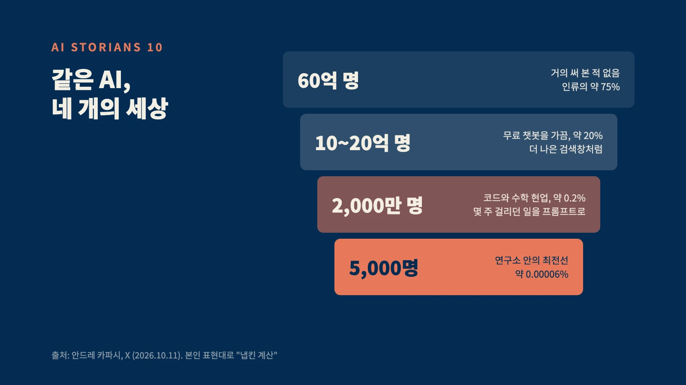
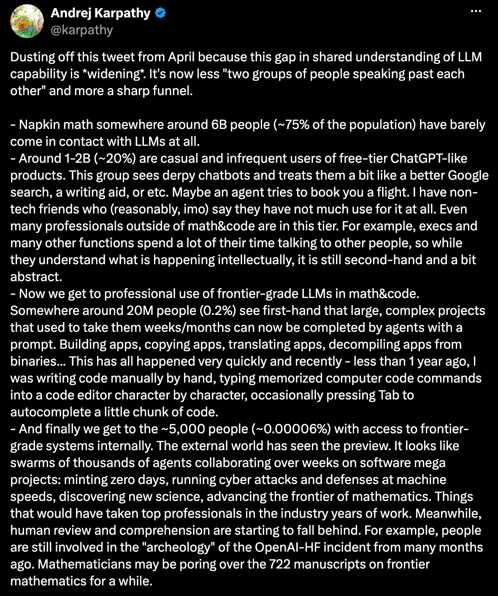

이번 주, 안드레 카파시가 X에 글을 하나 올렸다.
오픈AI 창립 멤버이자, 바이브 코딩이라는 말을 만든 사람이다.

사람들이 AI를 이해하는 수준이, 이제 하나의 날카로운 깔때기가 됐다는 글이었다.
본인 말로는, 냅킨 위에서 대충 해 본 계산이다.

약 60억 명. 인류의 75%는 AI를 거의 만나 본 적이 없다.
10억에서 20억 명은 무료 챗봇을 가끔 쓴다. 조금 나은 검색창 정도로.
2,000만 명, 0.2%는 몇 주 걸리던 일이 프롬프트 하나로 끝나는 걸 직접 본다.
그리고 약 5,000명. 연구소 안에서, 수천 개의 에이전트가 몇 주씩 함께 일하는 세상을 산다.

같은 AI다.
누군가에게는 엉성한 챗봇이고, 누군가에게는 곡선이 수직으로 솟는 현기증이다.
그리고 이 모든 일이 지금, 동시에 일어나고 있다.

재밌는 건, 이 연재가 처음부터 이 깔때기에 관한 이야기였다는 거다.

깔때기 위쪽의 99.9%.
AI를 만들지도, 연구소 안에 있지도 않은 우리가, 이 시대에 무엇으로 살아남고 무엇으로 빛날 것인가.

첫 글에서 이렇게 약속했다.
AI를 잘 쓰면 상위 1%가 될 수 있다.
AI가 대체할 수 없는 사람이 되어도 상위 1%가 될 수 있다.
둘을 같이 하면 0.1%. 그러면 AI 시대를 지배할 수 있다고.

마지막 글이다. 그 약속을 지켰는지, 확인해 보자.

## 1. 아홉 개의 문장, 세 개의 단어

이 연재는 매주 한 문장으로 끝났다.

메신저가 되어라. 정보는 싸다. 신뢰와 책임은 비싸다.
호스트가 되어라. 팔로워는 찍어낼 수 있다. 출석은 찍어낼 수 없다.
전통을 만들어라. AI는 무엇이든 만든다. 오래된 것만은 못 만든다.
좋은 과거를 가져라. 면접은 운이 좋을 수 있다. 과거에서는 도망칠 수 없다.
AI가 알 수 있는 과거를 만들어라. AI가 모르는 과거는, 존재하지 않는다.
길을 소유하라. 기능은 복제된다. 길은 복제되지 않는다.
자동화를 막을 수 있는 사람이 되어라. 실행이 공짜가 되면, 병목은 승인이 된다.
스토리텔러가 되어라. 정보는 무한하다. 전달은 무한하지 않다.

여덟 개다.
아홉 번째, 아니 맨 처음 문장은 마지막에 꺼내겠다.

이렇게 나란히 놓고 보니, 매주 같은 질문을 다른 말로 물었다는 걸 알겠다.
AI가 무엇이든 만들 수 있다면, 끝까지 만들어지지 않는 것은 무엇인가.

답은 세 단어로 줄어든다.

사람.
이름을 걸고 말하는 사람, 사람을 모으는 사람, "멈춰"라고 말하는 사람, 사람과 사람을 잇는 사람.
메신저, 호스트, 멈추는 사람, 스토리텔러는 모두 같은 자리에 서 있다. 신뢰와 책임을 지는 자리다.
AI는 일을 대신할 수 있다. 책임까지 대신하지는 못한다.

시간.
전통, 좋은 과거, AI가 알 수 있는 과거.
시간은 돈으로 살 수 없는 유일한 원자재다. 그리고 AI 시대의 시간은, 기록으로 남겨야 자산이 된다.

길.
만드는 능력이 흔해지면, 나르는 능력이 귀해진다.
개인에게는 명단이, 기업에게는 배포망이 길이다.

지능, 정보, 코드, 실행은 딸깍 한 번이면 나온다.
사람, 시간, 길은 딸깍으로 나오지 않는다.
이 연재는 그 차이에 관한 기록이었다.

## 2. 깔때기 아래로 내려가는 법

다시 카파시의 글로 돌아가자. 두 문장이 오래 남았다.

하나.
깔때기를 가르는 첫째 이유는, 문제의 크기라고 했다.
한 문단짜리 답을 원하는 질문으로는 AI를 거의 시험하지 못한다. 정말 마음 쓰는, 크고 어려운 문제를 가진 사람만 AI의 진짜 힘을 만난다.

둘.
가장 앞선 5,000명의 세상에서조차, 사람의 검토와 이해가 뒤처지기 시작했다고 했다.

이 두 문장을 겹쳐 보니, 첫 글에서 말한 0.1%가 보였다.

나는 AI를 잘 쓰는 능력과 AI가 대체할 수 없는 능력을, 서로 다른 재능이라고 생각하며 연재를 시작했다.
끝까지 쓰고 나서야 알았다. 둘은 같은 뿌리에서 나온다.

크고 좋은 문제를 고르는 눈.
그 문제를 AI가 알아듣는 이야기로 바꾸는 힘. 한 줄 대신, 네 줄.
돌아온 결과를 판별하고, 틀렸으면 멈추는 판단.
그리고 그 결과를 사람의 언어로 다시 전하는 능력.

AI를 가장 잘 쓰는 사람도, AI가 가장 대체하기 어려운 사람도, 결국 이야기를 가진 사람이다.
깔때기를 내려가는 계단과, 대체되지 않는 자리는, 같은 곳에 있었다.

이제 AI 시대를 지배한다는 말을 정의할 수 있다.
AI에게 무엇을 맡길지 내가 정하고, 그 결과에 내 이름으로 서명하는 것.

## 3. 첫 글에 남겨 둔 질문들

첫 글에서 질문만 던지고 넘어간 것들이 있다.
영어 공부는 해야 할까. 악기는, 스포츠는, 코딩은. 대학은. 우리 아이들은 어떤 사람으로 키워야 할까.

과목마다 답을 달 수도 있다.
하지만 열 번의 글을 쓰고 나니, 두 문장이면 충분했다.

대부분의 사람들은 하지 않을 것이다. 그래서 하는 사람이 더욱 귀중해진다.

AI가 다 해 주는데 영어를 왜, 악기를 왜, 코딩을 왜 배우냐고 묻는 시대다.
바로 그래서, 배우는 사람이 희소해진다. 그리고 희소한 것은 비싸다.

AI 시대에는 깊은 지식보다, 넓은 도메인 지식이 더 중요해진다.

한 우물을 깊이 파는 일은 AI가 순식간에 해낸다.
서로 다른 우물을 잇는 일은 사람이 한다.
이메일 하나가 법이 되고, 결제 하나가 회계가 되고, 글 하나가 평판이 되는 시대다.
그 교차점을 보는 사람이 멈춤 버튼을 쥐고, 이야기를 잇는다.

## 4. 이 연재가 실험이었다

고백할 게 하나 있다.
이 연재 자체가, 아홉 개의 문장을 직접 해 본 실험이었다.

매주 수요일, 같은 형식으로 썼다. 반복이 쌓이면 전통이 되니까.
이름을 걸고 썼다. 메신저는 서명하는 사람이니까.
AI가 읽을 수 있는 곳에 남겼다. 언젠가 누군가 AI에게 "AI 시대에 살아남는 법"을 물을 때, 답의 한 조각이 되도록.
투자 일지를 쌓아 온 것처럼, 이 기록도 나의 좋은 과거가 되기를 바라면서.

그리고 매주, 여러분이 와 주었다.
좋아요는 찍어낼 수 있어도, 출석은 찍어낼 수 없다.
열 번의 수요일 동안 와 준 출석이, 이 연재가 쌓은 가장 큰 자산이다.

솔직히 말하면, AI 시대를 지배하는 법을 쓴다면서 나도 매주 배우며 썼다.
모르는 건 찾아 읽고, 틀린 건 고치고, 지난 글을 다음 글에서 다시 불렀다.

결론: 역사로 시작해서, 역사로 끝난다

아껴 둔 첫 문장을 꺼낼 차례다.

2016년 8월, 가죽 재킷을 입은 아저씨가 박스 하나를 들고 샌프란시스코의 작은 연구소 문을 두드렸다.
박스 안에는 세계 최초의 AI 슈퍼컴퓨터가 있었고, 그는 그 위에 매직으로 이렇게 적었다.
"컴퓨팅과 인류의 미래를 위해."

그 컴퓨터는 미래를 계산하지 않았다.
과거를 읽었다.
인류가 쌓아 온 글과 대화와 기록을, 밤낮없이 읽고 또 읽었다.

GPT의 P는 Pre-trained, 미리 훈련됐다는 뜻이다.
AI 시대를 연 이름 한가운데에, 과거가 박혀 있다.
깔때기 맨 아래 5,000명이 다루는 기계도, 그 기록을 먹고 자랐다.

가장 미래지향적인 기술은, 100% 과거로 만들어졌다.

60여 년 전, 역사학자 E.H. 카는 이렇게 썼다.
"역사란 과거와 현재의 끊임없는 대화다."

AI가 하는 일이 정확히 그거다.
그리고 지난 열 번의 수요일 동안, 이 연재가 한 일도 그거였다.

그래서 이 연재의 첫 문장은 이거였다.
우리 모두가 AI 시대의 역사학자다.

역사학자는 미래를 예언하지 않는다.
과거를 읽고, 과거를 남긴다.
그리고 미래는 언제나, 그 기록 위에 세워졌다.

젠슨 황이 박스 위에 적은 문장을 다시 보자.
컴퓨팅의 미래는, 그 박스 안에 있었다.
인류의 미래는 박스 밖에, 우리가 남기는 기록 속에 있다.

그러니 오늘, 하나만 해 보라.
이름을 걸고, AI가 읽을 수 있는 곳에, 기록 하나를 남겨라.
다음 주 같은 요일에, 하나 더.

대부분은 하지 않을 것이다.
그래서 하는 당신이, 귀해진다.

Story와 Historian.
과거를 읽는 데서 멈추지 않고, 우리의 이야기로 역사를 만드는 사람.

AI 시대에서 이기고 싶다면, 스토리언즈가 되어라.
Be a Storian.

— 제이킴모건, ai storian
