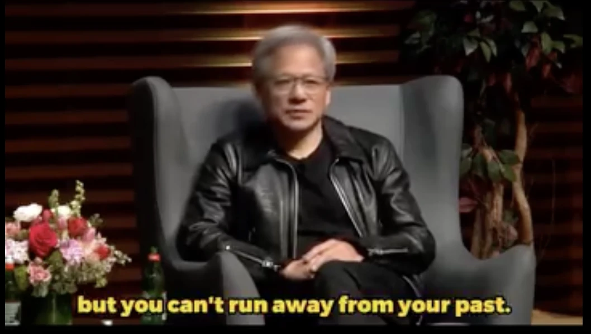

1993년, 실리콘밸리.

서른 살의 엔지니어가 회사를 그만두고 창업을 준비하고 있었다. 패밀리 레스토랑 데니스의 구석 부스에서 구상한 사업이었다.

투자자를 찾던 중, 전 직장의 보스에게 연락이 온다. 반도체 회사 LSI 로직의 창업자, 윌프 코리건.

자기 회사를 떠난 직원이 사업을 시작한다니, 궁금해서 부른 거다.

이 젊은 엔지니어는 전 직장 회장님 앞에서 열심히 사업계획을 피칭했다.

피칭이 끝나고, 윌프가 말한다.

"뭔 소린지 하나도 모르겠다. 내가 들어본 피칭 중, 최악이었다."

그런데 윌프는 그 자리에서 수화기를 든다. 전화를 받은 사람은 돈 밸런타인.

애플에 초기 투자한 전설, 세쿼이아 캐피털의 창업자다.

"돈(Don), 내가 아는 친구 하나 보낼게.

뭘 하려는 건지는 모르겠는데, LSI를 거쳐간 최고의 직원 중 하나야. 돈 좀 줘."

이렇게 이 회사는 투자를 받았고, 그 엔지니어의 이름은 젠슨 황. 그 회사의 이름은, 엔비디아다.

피칭은 낙제했다. 전 직장 보스도 "최악"이라 했고, 실제로 세쿼이아 캐피털 돈 밸런타인 앞에서도 긴장해서 피칭에서 실수가 많았다.

그런데 투자는 성사됐다. 심사된 건 그날의 퍼포먼스가 아니었다.

젠슨 황이라는 사람이 회사에서 보낸 시간, 함께 일한 사람들이 기억하는 모습. 과거Past였다.

젠슨은 여기서 인생의 교훈을 얻었다고 말한다. 그리고 어느 인터뷰에서 이렇게 정리했다.

"면접은 운 좋게 잘 볼 수 있다. 하지만 과거로부터는 도망칠 수 없다.

그러니, 좋은 과거를 가져라. So, have a good past."

고백하자면, 나는 이 사람을 꽤 오래 지켜봤다. 2018년부터 GPU의 중요성을 눈치채고 엔비디아에 투자했고, 상당 수를 매도했지만, 여전히 일반인 치고는 상위권에 속하는 수량을 갖고있다고 생각한다. 당연히 억대가 넘는다.

나는 젠슨 황이 나온 인터뷰를 거의 외울 정도로 찾아봤다. 그 많은 인터뷰 중에서, 이 말이 나온 인터뷰는 아마 대부분 들어본 적 없을 거다. 유명한 어록은 아니다. 하지만 나는 이게 젠슨 황의 말 중에서, AI 시대에 가장 중요한 문장이라고 생각한다.

AI 시대는 과거가 심사하는 시대다

첫 번째 이유는 이 책의 첫 페이지에서 이미 말했다.

AI라는 가장 미래지향적인 기술은, 100% 과거로 만들어졌다. AI는 인류가 쌓아온 기록, 그러니까 과거를 학습해서 태어난 기술이다. 과거를 재료로 만들어진 기술이 세상을 지배하는 시대에, 과거의 값이 오르는 건 당연하다.

두 번째 이유가 더 실전적이다.

오늘의 퍼포먼스는, 이제 AI가 만들어준다.

자소서는 딸깍이면 나온다. 면접 예상 질문과 모범 답안도 딸깍이다. 포트폴리오도, 제안서도, 피칭 덱도 하루면 그럴듯하게 만들어진다. 모두의 '오늘 퍼포먼스'가 상향 평준화되는 중이다.

그럼 심사하는 쪽은 어떻게 할까? 모두가 잘하는 것으로는 아무도 가려낼 수 없다. 심사관들은 위조할 수 없는 것으로 후퇴한다.

그게 과거, Past다.

이 사람이 어디서 시간을 보냈는가. 무엇을 끝까지 해봤는가. 함께 일한 사람들이 뭐라고 기억하는가. 실패하고 어떻게 일어났는가.

젠슨의 피칭이 두 번 낙제하고도 투자받은 이유가, AI 시대에는 모두의 이유가 된다. 서류는 딸깍으로 만들 수 있지만, 평판은 딸깍으로 만들 수 없으니까.

면접은 하루면 준비할 수 있다. 과거는, 하루로는 안 된다.

우리는 이미 채점되고 있다

과거가 심사한다는 말이 추상적으로 들린다면, 주머니 속을 보면 된다.

우버 앱에는 별점이 있다. 중고 거래 앱에는 당신의 거래 온도가 있다. 은행에는 신용점수가 있고, 개발자에게는 깃허브 스타가 있다. 전부, 당신의 과거를 숫자로 압축한 것들이다.

이 숫자들의 공통점이 있다. 하루 만에 못 만든다. 돈 주고 못 산다. 그리고 한 번의 나쁜 행동으로 무너진다.

지난 화에서 전통을 얘기했다. 전통이란 무엇인가. 집단이 함께 쌓아온, 좋은 과거다. 마스터즈가 90년의 좋은 과거로 세계관이 됐듯이, 개인의 좋은 과거는 그 사람의 전통이 된다.

좋은 과거는, 나라는 브랜드의 전통이다.

"저는 좋은 과거가 없는데요?"

여기까지 읽고 이런 생각이 들 수 있다. 나는 내세울 과거가 없는데. 실패만 쌓였는데. 늦은 것 아닌가.

나도 실패를 엄청나게 해본 사람이다. 이불킥도 수없이 차봤다. 그런 사람으로서, 이 말을 꼭 하고 싶다.

오늘도, 내일이 오면 과거가 된다.

미래는 계획할 수 있을 뿐이다. 현재는 흘러갈 뿐이다. 우리가 만들 수 있는 유일한 시제는, 과거다.

Have a good past는 결국 이 말이다. Make good choices today. 오늘부터 좋은 선택을 하자. 오늘을 당당하게 살자.

투자도 똑같다. 운 좋게 일확천금을 노릴 수도 있다. 마음만 먹으면 도파민 어그로를 끌 수도 있다. 내가 그러지 않는 이유가 바로 이거다. 지금까지 쌓아온 투자 일지, 그리고 그걸 보여주는 기록. 이게 나의 좋은 과거다. 이걸 해치고 싶지 않아서다.

기록은 복리로 쌓인다. 그리고 단 한 번의 거짓으로 전액 청산된다. 이 시리즈에서 계속 반복해온 문장이, 여기서도 그대로 작동한다.

우리의 AI에게도 과거를 주어라

그리고 이 얘기는 사람에서 끝나지 않는다.

지금 우리가 쓰는 AI를 보자. 당신이 나눈 대화, 가르쳐준 맥락, 쌓아준 기록을 먹으면서 당신의 AI는 당신을 닮아간다. 우리가 AI를 '트레이닝'한다는 건, AI에게 과거를 만들어주고 있다는 뜻이다.

똑같은 모델을 써도 결과가 다른 이유가 이거다. 아무 기록도 없는 AI는 누구의 것도 아니다. 당신의 과거를 먹은 AI는, 세상에 하나뿐이다.

AI 시대에 절대 따라잡을 수 없는 것은 인간이 쌓아온 신뢰, 책임, 경험이다. 우리는 그것을 그냥, 과거라고 부를 뿐이다.

그러니 AI 시대일수록, 스스로의 과거를 가꾸자. 그리고 AI 시대이기 때문에, 우리의 AI 에이전트들에게도 서사를 주자. 그것이 가장 큰 자산이 될 것이다.

도망칠 수 없다면, 자랑스럽게 만들어라

젠슨 황의 문장을 다시 보자.

"You can't run away from your past. 과거로부터 도망칠 수 없다."

무서운 말처럼 들린다. 하지만 뒤집으면 희망이다. 도망칠 수 없다는 건, 사라지지 않는다는 뜻이다. 오늘 쌓은 좋은 하루도, 똑같이 사라지지 않는다.

그래서 나는 AI 시대에 꾸준함이 더욱더 중요해질 거라 생각한다. 지금부터라도 좋은 과거를 만들자.

피칭은 낙제해도 된다. 젠슨도 두 번 낙제했다. 젠슨은 이 낙제한 과거마저 지금의 스토리로 사용하고 있다.

내 말을 믿지 못하겠다면, 4조 달러 회사를 만든 남자의 말이라도 믿어라.

AI 시대에서 이기고 싶다면, 좋은 과거를 가지자.

So, have a good past.

— 제이킴모건, ai storian
