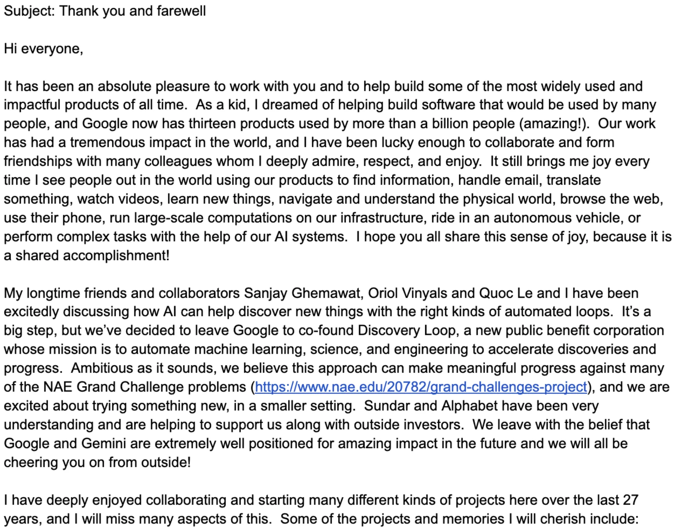
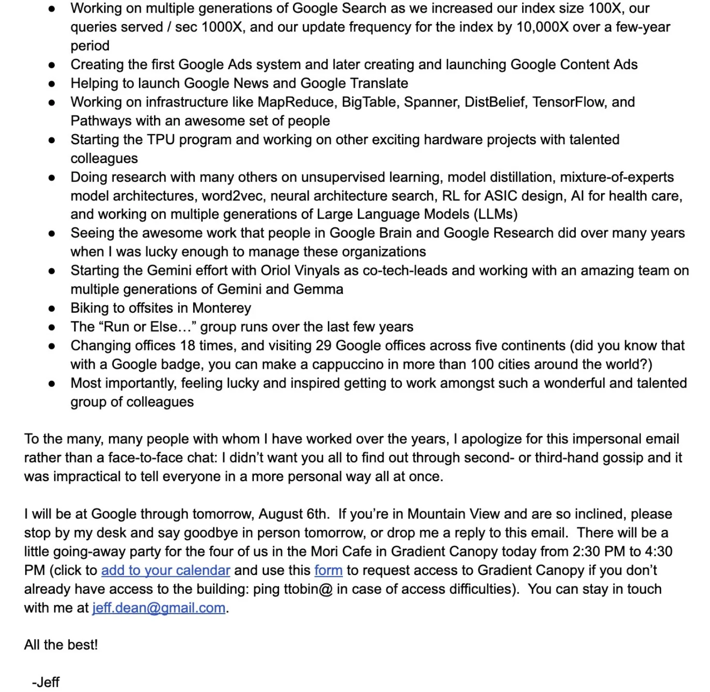
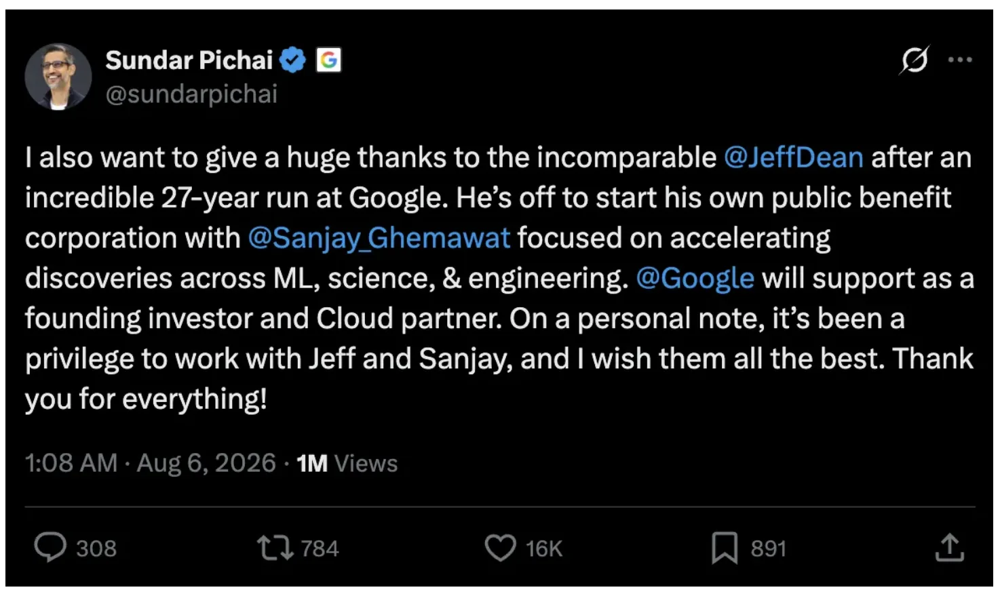

On August 5, Alphabet suddenly dropped nearly 5% intraday.  
Roughly $200 billion in market value, gone within hours.

It wasn’t an earnings shock.  
No lawsuit. No regulation. No rival’s shiny new model.

Thanks for reading ai Storians! Subscribe for free to receive new posts and support my work.

The cause was exactly one thing. Or more precisely, one person.  
His name is Jeff Dean. This employee at Google announced his departure with an email.

Subject: Thank you and farewell.

You’re right. Jeff Dean is not just an employee. He was Google’s Chief Scientist, and one of TIME’s 100 Most Influential People in AI (2025). Among the developer circle, he’s Chuck Norris.

This news was big enough to flip the market, removing $200 billion in Alphabet’s market value. Investors were furious. Rightfully so, their dearest stock went down 5%.

And that is a sad part. We seemed to have forgotten what really matters in life. In the midst of this generational technology revolution and wealth creation, we are missing the most important factor in capitalism and in life.

That’s *people*.

Before I explain why this matters, I want you to read the email Jeff Dean sent out. It’s long. But this email has everything. Far better than what I can offer.

  

Jeff Dean, the author of this email, is a legend.

In 1999, Jeff Dean joined a startup with 25 employees.  
The company was called Google.

Here is some of what passed through his hands over the next 27 years.

-   The heart of Google Search: the index grown 100x, queries per second grown 1,000x, in the span of a few years.
  
-   Google’s first ads system. The launches of Google News and Google Translate.
  
-   MapReduce, BigTable, Spanner. If the names mean nothing to you, think of them as the basic plumbing of today’s cloud.
  
-   TensorFlow, the standard toolkit of the deep learning era.
  
-   The TPU, Google’s AI chip program. He started it.
  
-   And Gemini. Co-tech-lead of Google’s AI.
  

In short, a remarkable share of the internet and the AI you use every day passed through **this one person**. Google has thirteen products with more than a billion users each. His fingerprints are on many of them.

Among engineers, Jeff Dean isn’t merely famous. He is a god. The Chuck Norris of Engineers.

*“Jeff Dean’s PIN is the last four digits of pi.”*

No engineer has ever been loved like this. And this man is leaving Google after 27 years.

For shareholders, the news ends here.  
***Key-man risk. Leadership doubt. Sell.***

I read the same email and saw something else.  

---

## **The People**

Look at that farewell list again.  
Right next to the world-changing achievements, the 100x index and the TPU, he mentioned a bike ride, a running club, and a cappuccino.

In the 27-year closing statement of a man who built some of the largest systems on Earth, he ended his letter with the people. The greatest engineer of his generation summed up 27 years, and the final entry was people. The people that he worked with and the people he will be working with.

> **Most importantly, feeling lucky and inspired getting to work amongst such a wonderful and talented group of colleagues**

He isn’t leaving alone, either. He goes with Sanjay Ghemawat, his coding partner of 27 years, the duo The New Yorker once profiled as “The Friendship That Made Google.” Add Oriol Vinyals and Quoc Le, and four legends of Google AI walk out the door together.

And the destination is not retirement.

Discovery Loop: a public benefit corporation that wants to automate scientific and engineering discovery itself with machine learning. The stated targets are grand-challenge problems for humanity.

A 58-year-old legend decided he wanted to try “something new, in a smaller setting,” and became a founder.

Sundar Pichai and Alphabet, instead of making a scene to keep him, chose to become a founding investor and Cloud partner. Pichai congratulated him publicly: “It’s been a privilege to work with Jeff and Sanjay.”

  

This is not a power struggle. This is not a leadership collapse.  
It is simply the beautiful new beginning of a legendary engineer.

But most of the market filed it under “why Google stock fell.”

How far have we come?

I work with AI, and I study, research, and try to predict the AI era.  
And this is what has come to bother me most:

In all this speed, in all this technology, in the daily rise and fall of our accounts, we keep forgetting the most important thing.

Being good at investing matters. Learning about AI matters. But living a good life matters more.

When we invest, we start seeing only the ticker, not the people.

That is exactly what happened last week. The stock fell, so people worried about Google’s future and questioned Pichai’s leadership.

“If Jeff Dean had been made CEO instead of Pichai, he wouldn’t have left.” People are actually saying this.

(Pichai became Google’s CEO in 2015. If Jeff Dean were the type to leave because of Pichai, he’d have left a decade ago.)

Instead of holding him back, the company congratulated him and became his first investor. No coup. No purge. No feud. Just a beautiful farewell.

A man spends 27 years at one company, and only at 58 does he hand in his resignation to start again, to solve problems for mankind.

And we are so nearsighted that we can only look for the reasons why the stock went down.

How far have we come? Apparently, not so much.

So. Shall I sell Google?

---

## **The Company**

To a shareholder, this email is bad news that knocked 5% off Google.

But the same email is the end, the turning point, and the new beginning of a 27-year journey for one of the humans who built the modern internet and AI.

I find it a little sad how few investors and AI enthusiasts got this.

I am a Google shareholder myself. So when Google fell, my account felt it, too. And still, reading this news and this email, what I felt was not worry. It was being moved.

Google is the company where a person like Jeff Dean stayed for 27 years.

Google is not “the company Jeff Dean left.”

It is the company Jeff Dean spent 27 years building.  
And, at the same time, the company that spent 27 years building Jeff Dean.  
The company where the people he trained still work.  
The company where new Jeff Deans keep coming up.

If the company he built were crumbling, he is the last person on Earth who would walk away. That’s the kind of man who Jeff Dean is.

And maybe the bigger lesson is this:

**Be like Jeff Dean.**

The kind of man who changes the world with technology, and still cared about his colleagues more than anything else.

The kind who breaks the news himself, and invites everyone to stop by his desk on the last day.

The kind who is not afraid to start over at 58 with his best friends.

This is the part that people who only watch the ticker or compare the models every day never get to see.

If there is one thing to take from this news, it is not whether Google’s stock went up or down.

It is this: may we all, someday, end with respect and start with confidence.

  

\- [JKIMMORGAN](https://open.substack.com/users/35931011-jkimmorgan?utm_source=mentions), ai storian
